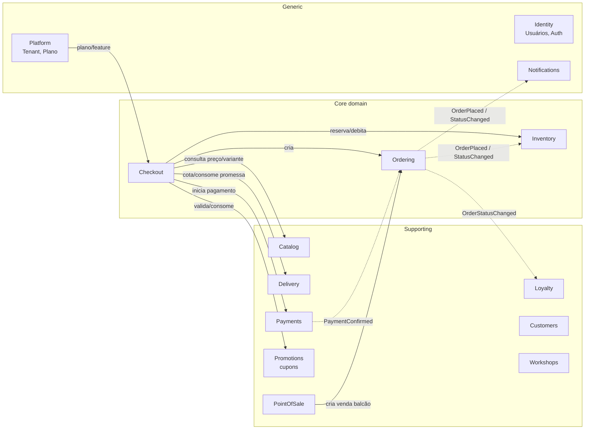
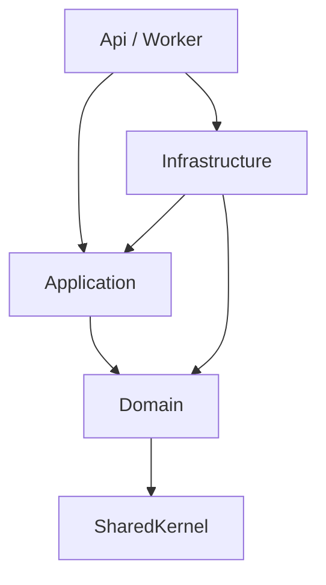
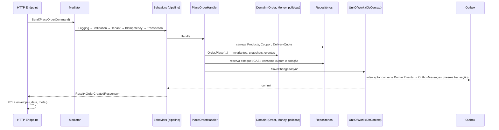
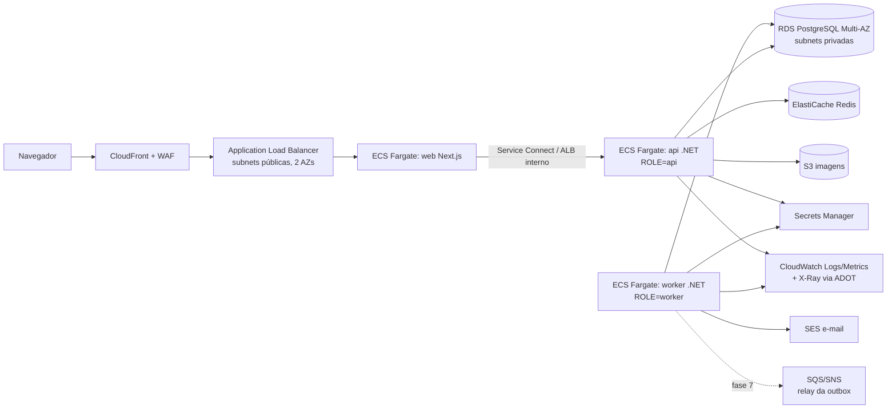

# Floruna em .NET — Plano de reescrita do backend

> Documento de partida para recriar a API do Floruna (hoje **NestJS 11 + MongoDB**, testada com **Jest**) em **C# / ASP.NET Core**, com Clean Architecture, DDD, CQRS, TDD e SOLID.
> Objetivo duplo: **sistema profissional** e **material de estudo e entrevista**.
> Base da análise: `~/Projects/diprosoft/flora-lis-site/api` (código) e `docs/arquitetura`, `docs/floralist`, `docs/implementation`, `docs/adr` (decisões já registradas).
> Data: 2026-11-18.

---

## Sumário

0. [Resumo executivo](#0-resumo-executivo)
1. [Diagnóstico do backend atual](#1-diagnóstico-do-backend-atual)
2. [Estratégia de reescrita](#2-estratégia-de-reescrita)
3. [Bounded contexts e mapa de contexto](#3-bounded-contexts-e-mapa-de-contexto)
4. [Requisitos funcionais](#4-requisitos-funcionais)
5. [Regras de negócio](#5-regras-de-negócio)
6. [Requisitos não funcionais](#6-requisitos-não-funcionais)
7. [Arquitetura da solução](#7-arquitetura-da-solução)
8. [Padrões de projeto: onde e por quê](#8-padrões-de-projeto-onde-e-por-quê)
9. [SOLID aplicado](#9-solid-aplicado)
10. [DDD tático: agregados, value objects e eventos](#10-ddd-tático)
11. [Persistência, multi-tenancy e concorrência](#11-persistência-multi-tenancy-e-concorrência)
12. [Padrões de nuvem](#12-padrões-de-nuvem)
13. [Estratégia de testes (TDD)](#13-estratégia-de-testes-tdd)
14. [Stack e pacotes](#14-stack-e-pacotes)
15. [Roadmap por fases](#15-roadmap-por-fases)
16. [Migração e convivência com o sistema atual](#16-migração-e-convivência)
17. [Guia de entrevista](#17-guia-de-entrevista)
18. [Decisões tomadas](#18-decisões-tomadas-2026-11-18)
19. [Arquitetura-alvo na AWS](#19-arquitetura-alvo-na-aws)

---

## 0. Resumo executivo

| Tema | Decisão recomendada |
|---|---|
| Runtime | **.NET 10 (LTS)**. |
| Estilo | **Monolito modular** com **Clean Architecture**: 4 camadas (`Domain`, `Application`, `Infrastructure`, `Api`) e pastas por bounded context dentro de cada camada. As fronteiras são verificadas por testes de arquitetura. |
| Banco | **PostgreSQL + EF Core**. Troca deliberada em relação ao Mongo (motivos na §11). |
| CQRS | Comandos e queries separados via **Mediator**. Escrita pelo modelo de domínio (EF Core); leitura por projeções (EF `AsNoTracking`/`Select` ou Dapper). |
| Multi-tenancy | `TenantId` em toda entidade de loja + **global query filter** do EF Core + falha fechada quando não há tenant. É a mesma garantia do `tenant-scope.plugin.ts` atual. |
| Efeitos colaterais | **Transactional Outbox** na mesma transação do agregado; **Inbox** para webhooks; ambos com **dead-letter**. Isso já corrige a dívida A2 do sistema atual. |
| Contrato HTTP | Compatível com o BFF Next.js: `/api/v1`, envelope `{ data, meta }` / `{ error: { code, message, issues }, meta }`, JWT HS256 com o mesmo `AUTH_SECRET` e header `x-tenant-host`. |
| Escopo | **Não** reescrever os 52 módulos. Fazer um **núcleo vendável** (catálogo, estoque FEFO, checkout, PIX, entrega, fidelidade) em fatias verticais. Os demais módulos ficam no backlog. |
| Testes | TDD de dentro para fora: domínio puro → handlers → integração com **Testcontainers** (Postgres real) → contrato HTTP. Mais **testes de arquitetura**. |

> **Observação:** o backend atual é **NestJS** (framework); **Jest** é só o framework de testes dele. O equivalente em .NET é ASP.NET Core para o framework e **xUnit** para os testes.

---

## 1. Diagnóstico do backend atual

### 1.1 Números

| Métrica | Valor |
|---|---|
| Linhas TypeScript em `api/src` | ~85.600 |
| Módulos de domínio | 52 |
| Schemas Mongoose | 84 (77 com `tenantId`) |
| Endpoints HTTP | ~288 |
| Jobs `@Cron` | 25 |
| Specs unitárias / e2e | ~169 / 4 arquivos e2e |
| Migrations | 37 |
| Tipos de evento na outbox | ~40 (`order.*`, `catalog.*`, `inventory.*`, `payment.*`, `refund.*`…) |

Maiores módulos: `orders` (7,2k linhas), `stock` (4,2k), `tenants` (3k), `loyalty` (2,8k), `payments` (2,5k), `settings`, `communications`, `products`, `delivery-capacity`.

### 1.2 O que o sistema atual faz bem e deve ser **mantido** na versão C#

| Prática atual | Onde está | Equivalente em .NET |
|---|---|---|
| Isolamento de tenant **fail-closed** (plugin Mongoose + AsyncLocalStorage) | `common/tenant-scope.plugin.ts` | `ITenantContext` scoped + `HasQueryFilter` + interceptor que carimba `TenantId` e lança exceção sem tenant |
| Dinheiro em **centavos inteiros** | todo o domínio | Value object `Money` (`long Cents`, `Currency`) |
| **Snapshots** imutáveis no item do pedido (preço, custo, receita, promessa) | `OrderItemPricingSnapshot`, `OrderCompositionSnapshot`, `OrderPromiseSnapshot` | Owned types do EF Core / colunas `jsonb` |
| Estoque com **compare-and-swap** (`$gte`) | `inventory-source.service.ts` | `UPDATE … SET qty = qty - @n WHERE qty >= @n` (`ExecuteUpdateAsync`) ou concorrência otimista com `xmin` |
| **Ledgers append-only** + projeção + reconciliação | `StockMovement`, `PaymentTransaction`, `LoyaltyEntry` | Mesmas tabelas, sem `UPDATE`/`DELETE`, mais um job de reconciliação |
| **Idempotência** por índice único | 27 índices `unique` | Índices únicos + `IdempotencyKey` nos comandos |
| **Outbox** na transação + **Inbox** com verify-by-fetch no webhook do Mercado Pago | `outbox/`, `payment-webhook.service.ts` | `OutboxMessage` / `InboxMessage` + `BackgroundService` |
| **Estados separados** (Order, Payment, Production, Fulfillment) | D-006 | Um enum/state machine por agregado |
| **Política de desconto como função pura** | `loyalty/loyalty-policy.ts` | Domain service estático e puro: ótimo para TDD |
| Contrato versionado e checado (OpenAPI no CI) | `openapi:check` | OpenAPI nativo do .NET 10 + snapshot test do documento |
| Fronteiras checadas por máquina | `scripts/check-architecture.mjs` | **NetArchTest** / **ArchUnitNET** |

### 1.3 Dívidas documentadas que a reescrita deve **corrigir**

Fonte: `docs/arquitetura/10-trade-offs-e-divida-tecnica.md`.

| # | Problema atual | Correção no desenho .NET |
|---|---|---|
| A2 | Outbox sem limite de tentativas nem dead-letter | `MaxAttempts` → estado `Dead`, alerta e endpoint de reprocessamento |
| M1 | `orders` é um "módulo deus" (fan-out 29) | Separar `Ordering` (agregado) de `Checkout` (orquestração). Os outros contextos **reagem a eventos** em vez de serem chamados |
| M2 | 22 ciclos entre módulos | Teste de arquitetura: um contexto só referencia o `Contracts` público de outro |
| M3 | Worker da outbox conhece todos os consumidores | Despacho por `INotificationHandler<TEvent>` (pub/sub interno, OCP) |
| M4 | Varredura O(lojas) a cada 10s | Outbox global ordenada por `NextAttemptAt`; o tenant vem da própria mensagem |
| M5 | Crons no mesmo processo da API | Mesmo binário com papel `api` ou `worker` (`Options`) |
| M7 | JWT simétrico compartilhado | Fase 1: HS256 por compatibilidade. Fase posterior: RS256 + JWKS |
| M10 | `fiscal` lê a coleção de `orders` | Proibido por teste de arquitetura; leitura via query pública do contexto |
| B3 | Labels de status duplicados | Enum único no domínio |

---

## 2. Estratégia de reescrita

### 2.1 Princípios

1. **Paridade de regras, não de linhas.** Portar as **regras de negócio** e os **contratos**, não a estrutura de 52 módulos.
2. **Fatias verticais.** Cada fase entrega um fluxo ponta a ponta (endpoint → handler → domínio → banco → teste) que roda de verdade.
3. **TDD no domínio primeiro.** Regras críticas (FEFO, empilhamento de desconto, state machine, BR Code PIX, capacidade de entrega) nascem de testes.
4. **Contrato compatível com o BFF.** O front Next.js deve conseguir apontar `API_URL` para a API .NET, endpoint por endpoint (Strangler Fig, §16).
5. **Simplicidade defensável.** Cada padrão precisa de uma justificativa que você consiga explicar numa entrevista. Padrão sem motivo sai.

### 2.2 Escopo

**MVP (núcleo vendável):** Plataforma e acesso (tenant, planos, usuários, auth) · Catálogo · Estoque (lotes FEFO, movimentos, reservas) · Clientes · Cupons · Checkout e Pedidos · Pagamentos (PIX offline + Mercado Pago) · Entrega (zonas, capacidade por janela, cotação) · Outbox/Inbox · Notificações por e-mail.

**Fase 2:** Fidelidade (cashback, níveis) · Eventos/oficinas com inscrição · PDV + caixa · Pedido personalizado com orçamento versionado · Substituição com consentimento · Reembolsos · Métricas.

**Backlog (fora do escopo inicial):** fiscal (NFC-e), WhatsApp, campanhas, outreach, CRM avançado, reviews, showcase, analytics/funil, IA de textos, i18n, domínios próprios, billing do SaaS com cobrança recorrente, composições versionadas e fila de montagem (D-004/D-014), compras (D-023).

> Motivo: sozinho, o MVP já cobre **todos** os padrões pedidos (DDD, CQRS, UoW, outbox, idempotência, concorrência, multi-tenancy). Portar o resto só adiciona volume, não aprendizado novo.

---

## 3. Bounded contexts e mapa de contexto



| Contexto | Agregados principais | Origem no código atual |
|---|---|---|
| **Platform** | `Tenant` (slug, plano, status, fuso, moeda) | `tenants`, `billing`, `settings` |
| **Identity** | `User` (admin/equipe), credenciais, sessão | `auth`, `users`, `access` |
| **Catalog** | `Product` (+ `Variant`), `Category`, `Collection` | `products`, `catalog`, `pricing`, `availability` |
| **Inventory** | `InventoryItem`, `StockLot`, `StockMovement`, `StockReservation`, `StockBalance` (projeção) | `stock`, `inventory` |
| **Promotions** | `Coupon`, `CouponRedemption` | `coupons` |
| **Delivery** | `DeliveryZone`, `CapacityRule`, `DeliveryQuote`, `PickupPoint`, `Fulfillment` | `delivery-zones`, `delivery-capacity`, `pickup-points`, `fulfillment` |
| **Checkout** | `CheckoutAttempt` (orquestração, sem estado de negócio próprio) | `orders/checkout*.ts` |
| **Ordering** | `Order` (+ `OrderItem`, snapshots, resoluções) | `orders`, `state-transitions` |
| **Payments** | `PaymentIntent` (+ `PaymentTransaction`), `Refund`, `WebhookInbox` | `payments` |
| **Customers** | `Customer`, `Address` | `customers`, `privacy` |
| **Loyalty** | `LoyaltyProgram`, `LoyaltyAccount`, `LoyaltyEntry` | `loyalty` |
| **Workshops** | `Workshop` (evento), `Registration` | `events` |
| **PointOfSale** | `CashSession` | `cash-sessions`, `orders/pos-sale.service.ts` |
| **Notifications** | `Notification`, templates | `mail`, `notifications`, `communications` |

**Regra de comunicação:**
- **Síncrona** (dentro do caso de uso, na mesma transação): via interface pública do contexto (`ICatalogQueries`, `IInventoryService`), declarada num projeto/pasta `Contracts`.
- **Assíncrona** (efeitos posteriores): via **eventos de integração** pela outbox.
- **Proibido:** um contexto acessar `DbSet` ou entidade de outro contexto.

---

## 4. Requisitos funcionais

Identificador `RF-<CONTEXTO>-<n>`. **P0** = MVP, **P1** = fase 2.

### Platform e Identity

| ID | Requisito | P |
|---|---|---|
| RF-PLT-01 | Cadastro self-service de loja (nome, slug único, dono), criando tenant no plano `free` e o usuário `master` | P0 |
| RF-PLT-02 | Resolver a loja pelo host (`{slug}.dominio`, domínio próprio) recebido em `x-tenant-host` | P0 |
| RF-PLT-03 | Suspender/reativar loja (superadmin). Loja suspensa não atende vitrine nem painel | P0 |
| RF-PLT-04 | Planos `free`, `essential`, `pro`, `complete` com limites e features (tabela na §5.1) | P0 |
| RF-PLT-05 | Configurações da loja: dados, horários, fuso, campos obrigatórios do checkout, regras de pagamento | P0 |
| RF-IAM-01 | Login de equipe (e-mail + senha) emitindo JWT com `sub`, `role`, `tenantId`, `sessionVersion` | P0 |
| RF-IAM-02 | Cadastro/login **opcional** de cliente | P0 |
| RF-IAM-03 | Papéis `superadmin`, `master`, `gerente`, `caixa`, `customer` | P0 |
| RF-IAM-04 | Revogar sessões incrementando `sessionVersion` (troca de senha, remoção de usuário) | P0 |
| RF-IAM-05 | Redefinição de senha por token de uso único com expiração | P0 |
| RF-IAM-06 | Limite de usuários por plano | P0 |
| RF-IAM-07 | 2FA e impersonação auditada pelo superadmin | P1 |

### Catalog

| ID | Requisito | P |
|---|---|---|
| RF-CAT-01 | CRUD de produto: slug único por loja, nome, descrição, imagens, categoria, ativo, destaque | P0 |
| RF-CAT-02 | Variantes com identidade estável, SKU, rótulo, preço próprio e status | P0 |
| RF-CAT-03 | Preço promocional (`discountPrice < price`) | P0 |
| RF-CAT-04 | Custo corrente do produto para cálculo de margem | P0 |
| RF-CAT-05 | Categorias (taxonomia) e coleções (curadoria/ocasião) | P0 |
| RF-CAT-06 | Listagem pública paginada com filtro (categoria, ativo) e busca textual | P0 |
| RF-CAT-07 | Teto de produtos e de imagens por produto conforme o plano | P0 |
| RF-CAT-08 | Vincular a variante a um `InventoryItem` (o que ela consome do estoque) | P0 |

### Inventory

| ID | Requisito | P |
|---|---|---|
| RF-INV-01 | Cadastro de item de estoque (haste, vaso, embalagem, item pronto) com unidade | P0 |
| RF-INV-02 | Entrada (reposição) criando **lote** com quantidade, custo unitário e validade opcional | P0 |
| RF-INV-03 | Saída por venda, perda e ajuste, consumindo lotes em **FEFO** | P0 |
| RF-INV-04 | Ledger de movimentos imutável e consultável (filtro por item, tipo, período) | P0 |
| RF-INV-05 | Saldo por item/local como **projeção** do ledger | P0 |
| RF-INV-06 | Reserva de estoque para pedido (`held → committed / released / expired`) | P0 |
| RF-INV-07 | Alerta de lotes a vencer e de estoque baixo | P0 |
| RF-INV-08 | Reconciliação periódica entre ledger e projeção, registrando divergências | P1 |

### Promotions

| ID | Requisito | P |
|---|---|---|
| RF-PRM-01 | CRUD de cupom: código único por loja, tipo `percent`, `fixed` ou `free_shipping`, validade, pedido mínimo, limite total e limite por cliente | P0 |
| RF-PRM-02 | Validar o cupom no carrinho (pré-visualização) sem consumir | P0 |
| RF-PRM-03 | Consumir o uso do cupom **na transação** do checkout | P0 |

### Delivery

| ID | Requisito | P |
|---|---|---|
| RF-DLV-01 | Zonas de entrega por CEP/bairro com taxa | P0 |
| RF-DLV-02 | Janelas de entrega (`manha`, `tarde`, `noite`) com horário de corte | P0 |
| RF-DLV-03 | Capacidade por dia da semana e por janela; exceções por data (bloqueio ou capacidade especial, ex.: Dia das Mães) | P0 |
| RF-DLV-04 | **Cotação de entrega** (promessa) com validade, usada uma única vez pelo checkout | P0 |
| RF-DLV-05 | Retirada em ponto de retirada | P0 |
| RF-DLV-06 | Fulfillment do pedido: `unassigned → scheduled → out_for_delivery → delivered / failed / cancelled` | P1 |

### Checkout e Ordering

| ID | Requisito | P |
|---|---|---|
| RF-ORD-01 | Criar pedido (vitrine) com itens, cliente, endereço/retirada, data/janela, cupom, mensagem do cartão, preferência de substituição, `idempotencyKey` | P0 |
| RF-ORD-02 | Login opcional: vincular ao cliente quando houver token | P0 |
| RF-ORD-03 | Leitura pública do pedido por `id + accessToken` | P0 |
| RF-ORD-04 | "Meus pedidos" para cliente autenticado | P0 |
| RF-ORD-05 | Painel: listar/filtrar pedidos (status, data, período), ver detalhes | P0 |
| RF-ORD-06 | Mudar status com histórico (ator, motivo, origem, data) | P0 |
| RF-ORD-07 | Cancelar pedido, liberando reservas e acionando reembolso quando houver pagamento | P0 |
| RF-ORD-08 | Expirar pedido abandonado (pagamento não iniciado/confirmado no prazo) | P0 |
| RF-ORD-09 | Rastrear as etapas do checkout (`quote`, `validate`, `reserve`, `persist`, `payment`) para observar o funil | P1 |
| RF-ORD-10 | Resoluções pós-venda: reembolso parcial e substituição | P1 |

### Payments

| ID | Requisito | P |
|---|---|---|
| RF-PAY-01 | Gerar **BR Code PIX** offline (EMV + CRC16) com a chave da loja e o valor | P0 |
| RF-PAY-02 | Confirmação manual de PIX offline pelo lojista, auditada | P0 |
| RF-PAY-03 | Mercado Pago: criar preferência/cobrança com o token **da loja** (só planos com gateway) | P0 |
| RF-PAY-04 | Webhook do Mercado Pago: gravar na inbox, consultar o status real no gateway e aplicar ao pedido | P0 |
| RF-PAY-05 | Ledger de pagamento (`PaymentIntent` → `PaymentTransaction`) | P0 |
| RF-PAY-06 | Reembolso integral (cancelamento) e parcial (pós-venda) | P1 |
| RF-PAY-07 | Reconciliação de pagamentos pendentes (polling do gateway) | P1 |

### Customers, Loyalty, Workshops, PointOfSale e Notifications

| ID | Requisito | P |
|---|---|---|
| RF-CUS-01 | Cadastro/edição do cliente, endereços | P0 |
| RF-CUS-02 | LGPD: exportar e anonimizar os dados do cliente | P1 |
| RF-LOY-01 | Programa de cashback/pontos com níveis, validade e regras de empilhamento | P1 |
| RF-LOY-02 | Crédito ao entregar o pedido, estorno ao cancelar, expiração | P1 |
| RF-EVT-01 | CRUD de oficina/evento (data, local, preço, capacidade) | P1 |
| RF-EVT-02 | Inscrição pública com controle atômico de vagas | P1 |
| RF-POS-01 | Abrir/fechar caixa com valor inicial, sangria e suprimento, e conferência no fechamento | P1 |
| RF-POS-02 | Venda de balcão com múltiplas formas de pagamento | P1 |
| RF-NOT-01 | E-mail transacional: pedido criado, mudança de status, recuperação de senha | P0 |
| RF-NOT-02 | Webhooks de saída para o lojista, com retry e DLQ | P1 |

---

## 5. Regras de negócio

Identificador `RN-<n>`. Cada regra vira **pelo menos um teste** (§13). Entre parênteses, a origem no código atual.

### 5.1 Plataforma e acesso

| ID | Regra |
|---|---|
| RN-01 | Toda entidade de loja pertence a exatamente um tenant. **O payload nunca escolhe o tenant**: ele vem do contexto da requisição. Sem contexto, a operação falha (`tenant-scope.plugin.ts`). |
| RN-02 | Um token só vale para a loja que o emitiu: `jwt.tenantId == tenant do host`; senão, 401 (`JwtStrategy`). |
| RN-03 | Loja `suspended` não atende requisições de vitrine nem de painel (`TenantResolverMiddleware`). |
| RN-04 | Limites por plano (`tenants/plans.ts`): |

| Limite | free | essential | pro | complete |
|---|---|---|---|---|
| Produtos | 25 | 150 | 1.000 | 5.000 |
| Imagens/produto | 3 | 5 | 8 | 8 |
| Pedidos/mês (fair-use, **medido, não bloqueia**) | 30 | 300 | 1.500 | 5.000 |
| Usuários | 1 | 2 | 5 | 15 |
| Armazenamento | 250 MB | 1 GB | 5 GB | 20 GB |
| Gateway (Mercado Pago) | ✗ | ✓ | ✓ | ✓ |
| Domínio próprio | ✗ | ✓ | ✓ | ✓ |
| PDV, Financeiro, CRM, Fidelidade, WhatsApp, Relatórios avançados | ✗ | ✗ | ✓ | ✓ |
| Fiscal, Integrações | ✗ | ✗ | ✗ | ✓ |

| ID | Regra |
|---|---|
| RN-05 | O teto de pedidos/mês **nunca** bloqueia o comprador final; é só um sinal de fair-use no painel. |
| RN-06 | `caixa` acessa apenas PDV, caixa e a leitura de produtos do PDV (`POS_ROLES`). |
| RN-07 | Trocar a senha ou remover um usuário incrementa `sessionVersion`, o que invalida tokens antigos. |

### 5.2 Catálogo

| ID | Regra |
|---|---|
| RN-10 | `slug` é único por loja. |
| RN-11 | `discountPrice`, quando existe, é `> 0` e `< price`. |
| RN-12 | Produto com variantes exige a escolha de uma variante no pedido ("Selecione uma variação…"). |
| RN-13 | Produto ou variante inativa não pode ser vendida ("Produto indisponível"). |

### 5.3 Estoque

| ID | Regra |
|---|---|
| RN-20 | **Saldo nunca negativo.** O débito é atômico: só ocorre se `disponível >= quantidade` (compare-and-swap). Sem oversell sob concorrência. |
| RN-21 | **FEFO**: saídas consomem primeiro o lote que vence antes. Lotes sem validade saem por último. Desempate pelo lote mais antigo. |
| RN-22 | Todo movimento (`entrada`, `venda`, `perda`, `ajuste`, `consumo`, `opening_balance`) é **append-only**, com `idempotencyKey` único. Correção se faz com movimento compensatório, nunca com edição. |
| RN-23 | O saldo (`StockBalance`) é **projeção** do ledger e precisa poder ser recalculado a partir dele. Não é uma segunda fonte de verdade (D-012). |
| RN-24 | A reserva tem dono (pedido), propósito, quantidade e expiração. Expirar ou liberar uma reserva é **idempotente**. |
| RN-25 | A reposição com custo informado atualiza o custo corrente do produto. A venda **congela** `unitCost` no item (COGS exato). |
| RN-26 | Lote vencido não é elegível para venda. Lote só é elegível se a vida útil cobrir a data prometida de entrega (regra floral 4). |

### 5.4 Cupons e descontos

| ID | Regra |
|---|---|
| RN-30 | Tipos: `percent` (0–100), `fixed` (centavos), `free_shipping` (zera o frete). |
| RN-31 | O cupom respeita validade, pedido mínimo, limite total e limite por cliente. O uso é consumido **na transação** do pedido. Se esgotar no meio do checkout: "O cupom se esgotou enquanto o pedido era finalizado". |
| RN-32 | **Ordem fixa de aplicação** (`loyalty-policy.ts`): (1) preço do item, já com promoção → (2) desconto de mercadoria (nível + cupom, combinados por `stackingMode`, limitados por `maxTotalDiscountPercent`) → (3) frete, zerado se o nível **ou** o cupom derem frete grátis → (4) cashback sobre o valor já descontado. |
| RN-33 | **Cashback não é desconto, é meio de pagamento.** Não entra no teto de desconto; tem teto próprio (`maxCashbackPercentOfOrder`) e saldo mínimo de resgate. |
| RN-34 | O pedido nunca chega a R$ 0,00 por cashback (PIX de valor zero é cobrança inválida). |
| RN-35 | Desconto nunca maior que o valor dos itens. |

### 5.5 Checkout e pedido

| ID | Regra |
|---|---|
| RN-40 | **Preços, frete, taxas e descontos são recalculados no servidor.** O valor enviado pelo cliente é ignorado. |
| RN-41 | **Idempotência:** a mesma `idempotencyKey` devolve o mesmo pedido, inclusive na corrida entre duas instâncias (o índice único decide quem vence; a perdedora devolve o pedido vencedor). |
| RN-42 | **Atomicidade:** débito/reserva de estoque, criação do pedido, consumo do cupom, consumo da cotação de entrega e eventos da outbox ficam numa **única transação**. A chamada ao gateway fica **fora** da transação. |
| RN-43 | O item congela **snapshots**: nome, rótulo da variante, preço unitário, custo unitário, regra de preço aplicada e promessa de entrega. Mudar o catálogo depois não altera o pedido. |
| RN-44 | A cotação de entrega precisa existir, não estar vencida, ser usada uma única vez e bater com método, data e janela do pedido. |
| RN-45 | Status do pedido: `pendente → confirmado → em_preparo → em_entrega → entregue`, ou `cancelado`. **Avanços podem pular etapas, mas nunca voltam.** `cancelado` só a partir de estados não finais (`order-status.constants.ts`). |
| RN-46 | Toda transição registra ator, motivo, estado esperado e chave de idempotência (D-007). Uma transição com estado esperado divergente falha com conflito. |
| RN-47 | Leitura pública do pedido exige `accessToken` aleatório (anti-enumeração de PII). |
| RN-48 | Cancelar libera as reservas. Se houver pagamento aprovado, abre reembolso. Se o reembolso falhar, **o pedido não é cancelado** ("Reembolso não confirmado. O pedido não foi cancelado"). |
| RN-49 | Preferência de substituição: `exact` (nenhuma substituição permitida), `preapproved` (a loja aplica dentro da política) ou `ask_me` (exige aprovação do comprador dentro do prazo). Nunca substituir silenciosamente (D-015). |

### 5.6 Entrega

| ID | Regra |
|---|---|
| RN-50 | Data no formato `AAAA-MM-DD`, interpretada no **fuso da loja**. |
| RN-51 | Não aceita data em que a loja não entrega ("A loja não entrega nesta data"). |
| RN-52 | Não aceita janela cujo horário de corte já passou ("O prazo para esta janela de entrega já passou"). |
| RN-53 | Não aceita janela lotada. O consumo da capacidade é atômico ("Esta janela de entrega está lotada"). |
| RN-54 | Frete vem da zona do CEP. CEP fora das zonas → sem entrega (só retirada). |

### 5.7 Pagamentos

| ID | Regra |
|---|---|
| RN-60 | PIX offline é só **iniciação**. A confirmação é manual e auditada (quem, quando) ou vem do provider (D-010). |
| RN-61 | Webhook: **não confiar no corpo**. Gravar `providerPaymentId` na inbox (índice único) e consultar o status real no gateway com o token da loja (verify-by-fetch). Responder 200 mesmo se o processamento falhar, porque um job reprocessa. |
| RN-62 | `PaymentIntent`: `requires_action → pending → authorized/paid → refunded`, ou `failed`/`cancelled`. O ledger (`PaymentTransaction`) é append-only. |
| RN-63 | Pagamento aprovado → pedido `pendente → confirmado` (transição com ator `system:gateway`). |
| RN-64 | PDV: a soma das formas de pagamento precisa bater exatamente com o total. |
| RN-65 | Reembolso: um por vez por pedido ("já está em processamento"). Integral acompanha o cancelamento; parcial é devolução pós-venda. |

### 5.8 Fidelidade, oficinas, caixa e orçamento (fase 2)

| ID | Regra |
|---|---|
| RN-70 | O razão de fidelidade é append-only, com `dedupeKey` única por loja. O saldo é derivado e reconciliável (ADR 0003). |
| RN-71 | Cashback é creditado quando o pedido é **entregue** e estornado se o pedido for cancelado. |
| RN-72 | Inscrição em oficina é atômica: só ocorre se `inscritos < capacidade` ("Evento esgotado"). |
| RN-73 | Um operador tem no máximo **um caixa aberto** por vez. Venda de PDV exige caixa aberto. |
| RN-74 | Orçamento de pedido personalizado: `draft → published → accepted/rejected/expired → converted`. Depois de publicado, só muda com nova versão. Vencido não pode ser aceito. Vira pedido uma única vez. |

---

## 6. Requisitos não funcionais

| ID | Categoria | Requisito | Como verificar |
|---|---|---|---|
| RNF-01 | Desempenho | Checkout p95 < 800 ms; leitura de catálogo p95 < 150 ms | k6 no CI noturno |
| RNF-02 | Escalabilidade | API stateless; papéis `api` e `worker` separáveis; escala horizontal sem sessão em memória | 2 réplicas no compose de testes |
| RNF-03 | Capacidade sazonal | Suportar pico de 10–20x no Dia das Mães sem oversell | Teste de carga com concorrência no mesmo SKU |
| RNF-04 | Consistência | Forte para estoque, pedido e cupom; eventual (< 1 min) para ledger, notificações e fidelidade | Testes de integração + métrica de idade da outbox |
| RNF-05 | Confiabilidade | Nenhum efeito colateral perdido (outbox/inbox), retry com backoff, dead-letter com alerta | Teste que derruba o worker no meio |
| RNF-06 | Segurança | OWASP ASVS nível 2: senhas com hash forte, rate limit em auth/checkout, headers de segurança, CORS restrito, validação de entrada, segredos fora do repositório | Testes + `dotnet list package --vulnerable` no CI |
| RNF-07 | Isolamento | Vazamento entre lojas é impossível por construção (falha fechada) | Teste que tenta ler dado de outra loja em **todo** repositório |
| RNF-08 | Observabilidade | Logs estruturados com `requestId` e `tenantId`, tracing OpenTelemetry, métricas (pedidos, idade da outbox, falhas de webhook), health `/health/live` e `/health/ready` | Dashboard local com Aspire |
| RNF-09 | Manutenibilidade | Regras de dependência verificadas no CI; cobertura ≥ 90% no Domain, ≥ 80% no Application | NetArchTest + Coverlet |
| RNF-10 | Contrato | OpenAPI versionado; mudança incompatível quebra o CI | Snapshot do `openapi.json` |
| RNF-11 | Privacidade | LGPD: exportação e anonimização; sem PII em logs nem em eventos de analytics | Teste de redaction no logger |
| RNF-12 | Portabilidade | Sobe com `docker compose up`; configuração só por variáveis de ambiente/Options validadas no boot | Smoke test no CI |
| RNF-13 | Dinheiro | Nenhum `double`/`float` em valores monetários | Teste de arquitetura |
| RNF-14 | Tempo | Nenhum `DateTime.Now` no domínio; tempo via `TimeProvider` injetado | Teste de arquitetura / analyzer |

---

## 7. Arquitetura da solução

### 7.1 Estrutura

```
floruna-dotnet/
├─ Floruna.sln
├─ Directory.Build.props          # nullable, warnings as errors, analyzers, LangVersion
├─ Directory.Packages.props       # Central Package Management
├─ docker-compose.yml             # postgres, (redis), api, worker, seq/aspire-dashboard
├─ src/
│  ├─ Floruna.SharedKernel/        # Entity, AggregateRoot, ValueObject, Result, Error, IDomainEvent, Money
│  ├─ Floruna.Domain/              # regras puras — SEM dependência de framework
│  │  ├─ Catalog/   Inventory/   Ordering/   Payments/   Delivery/
│  │  ├─ Promotions/   Customers/   Loyalty/   Platform/   Identity/
│  ├─ Floruna.Application/         # casos de uso (CQRS), portas, validação, behaviors
│  │  ├─ Abstractions/  (ICommand, IQuery, IUnitOfWork, ITenantContext, IClock…)
│  │  ├─ Behaviors/     (Validation, Logging, Transaction, Idempotency, Tenant)
│  │  ├─ Catalog/Products/CreateProduct/  {Command, Handler, Validator}
│  │  ├─ Ordering/Checkout/PlaceOrder/    {Command, Handler, Validator}
│  │  └─ …
│  ├─ Floruna.Infrastructure/      # EF Core, repositórios, outbox, gateways, e-mail, auth
│  │  ├─ Persistence/ (FlorunaDbContext, Configurations/, Migrations/, Interceptors/)
│  │  ├─ Outbox/  Inbox/  Payments/MercadoPago/  Pix/  Email/  Identity/
│  ├─ Floruna.Api/                 # Minimal APIs ou Controllers, middleware, ProblemDetails/envelope
│  └─ Floruna.Worker/              # (opcional) host só com BackgroundServices
└─ tests/
   ├─ Floruna.Domain.UnitTests/
   ├─ Floruna.Application.UnitTests/
   ├─ Floruna.IntegrationTests/    # Testcontainers Postgres + WebApplicationFactory
   ├─ Floruna.ArchitectureTests/
   └─ Floruna.Api.ContractTests/   # snapshot do OpenAPI + envelope
```

### 7.2 Regra de dependência



- **Domain** não conhece EF, ASP.NET, Mediator nem JSON.
- **Application** define **portas** (`IOrderRepository`, `IPaymentGateway`, `IUnitOfWork`); **Infrastructure** implementa os **adaptadores**.
- **Api** é o **composition root**: só registra o DI e mapeia HTTP → comando/query.
- Dentro de cada camada, uma pasta de contexto **não** referencia o namespace interno de outra. Exceção: o `Contracts` público (testado por NetArchTest).

### 7.3 Fluxo de uma requisição de escrita



### 7.4 Contrato HTTP (compatibilidade com o BFF atual)

- Prefixo `/api/v1`; `x-tenant-host` resolve a loja; `Authorization: Bearer` com JWT HS256 (`AUTH_SECRET` ≥ 32 caracteres, o mesmo que o `proxy.ts` verifica).
- Sucesso: `{ "data": …, "meta": { "requestId", "timestamp", "version": "1" } }`.
- Erro: `{ "error": { "code", "message", "issues?" }, "meta": … }`. `code` é **contrato estável**; `message` é diagnóstico em pt-BR.
- Mapeamento: `Result.Failure(Error)` → status HTTP pelo tipo (`Validation` 400, `NotFound` 404, `Conflict` 409, `Forbidden` 403, `Unauthorized` 401).
- Swagger/OpenAPI em `/api/docs` e `/api/openapi/v1.json`.

---

## 8. Padrões de projeto: onde e por quê

| Padrão | Categoria | Onde no Floruna | Por que aqui |
|---|---|---|---|
| **Dependency Injection** | Arquitetural / nativo | `Program.cs` + `AddApplication()`, `AddInfrastructure()` por camada | Handlers dependem de portas; os testes trocam as implementações |
| **Repository** | Corporativo (Fowler) | Um por **agregado** (`IOrderRepository`, `IProductRepository`), nunca um por tabela | Esconde EF do domínio; expõe só operações que o agregado precisa |
| **Unit of Work** | Corporativo | `IUnitOfWork.SaveChangesAsync` (o `DbContext` já é um UoW); `TransactionBehavior` abre a transação por comando | Checkout grava pedido, reserva, cupom e outbox atomicamente (RN-42) |
| **Mediator** | GoF comportamental | Endpoints só fazem `mediator.Send(command)` | Controllers enxutos; pipeline transversal |
| **CQRS** | Arquitetural | `ICommand<T>` passa pelo domínio + UoW; `IQuery<T>` lê com `AsNoTracking`/projeção e não abre transação | Leituras do painel e da vitrine são muito mais frequentes e têm outra forma |
| **Pipeline / Decorator** | GoF estrutural | `IPipelineBehavior`: Logging, Validation, Tenant, Idempotency, Transaction, Performance | Regras transversais sem tocar no handler (OCP) |
| **Options Pattern** | .NET | `JwtOptions`, `MercadoPagoOptions`, `OutboxOptions`, `PlanOptions`, com `ValidateDataAnnotations().ValidateOnStart()` | Configuração tipada e **fail-fast** no boot (substitui o Joi atual) |
| **Singleton** | GoF criacional | Lifetime **Singleton do DI** para `TimeProvider`, `IPixBrCodeGenerator` (stateless), `IPlanCatalog` (tabela imutável), `JsonSerializerOptions`, `HttpClient` via `IHttpClientFactory` | Objetos sem estado ou imutáveis, caros de criar. **Nunca** `static Instance` manual: singleton via DI continua testável. **Nunca** singleton que capture um serviço scoped (captive dependency) |
| **Strategy** | GoF comportamental | `IDiscountStrategy` por tipo de cupom (`Percent`, `Fixed`, `FreeShipping`); `IPaymentGateway` (`PixOffline`, `MercadoPago`); `IStockAllocationStrategy` (FEFO; futuramente FIFO) | Novo tipo sem `switch` espalhado (OCP) |
| **Factory / Factory Method** | GoF criacional | `Order.Place(...)`, `StockLot.Receive(...)`: construtores privados e fábricas estáticas que validam invariantes; `PaymentGatewayFactory` escolhe o gateway pelo plano/configuração da loja | Objeto inválido não chega a existir |
| **State** | GoF comportamental | Máquina de estados de `Order`, `PaymentIntent`, `Reservation`, `Quote` (tabela de transições permitidas) | RN-45/46/62/74 num lugar só, testável |
| **Specification** | DDD | `ActiveProductsInCategorySpec`, `LotsEligibleForSaleSpec(date)` | Critérios de consulta reutilizáveis e nomeados |
| **Result / Notification** | Funcional | `Result<T>` + `Error(code, message, type)` em vez de exceções para fluxo de negócio | Erros de regra são valores previsíveis; exceção fica para o inesperado |
| **Domain Events** | DDD | `OrderPlaced`, `OrderStatusChanged`, `PaymentConfirmed`, `StockLotExpiringSoon` | Desacopla efeitos (fidelidade, e-mail, ledger) do agregado |
| **Adapter / Anti-Corruption Layer** | GoF estrutural / DDD | `MercadoPagoPaymentGateway` traduz a API externa para `PaymentStatus` do domínio | O vocabulário do gateway não vaza para o domínio |
| **Template Method** | GoF comportamental | `BackgroundJob` base (lock, tenant, métricas, try/catch) com `ExecuteBatchAsync` abstrato para outbox, reconciliação e expiração | Os crons atuais repetem esse boilerplate |
| **Null Object** | GoF | `NoOpNotificationChannel` em dev/teste | Sem `if (channel != null)` |
| **Builder** | GoF criacional | Test Data Builders (`OrderBuilder.Default().WithItem(...)`) | Testes legíveis |

---

## 9. SOLID aplicado

| Princípio | Exemplo concreto no Floruna |
|---|---|
| **S**ingle Responsibility | `PlaceOrderHandler` só **orquestra**; preço vem de `PricingService`, desconto da `DiscountPolicy` (pura), frete da `DeliveryQuote`, estoque do `IInventoryService`. No atual, `CheckoutService` + `orders` acumulam tudo (fan-out 29). |
| **O**pen/Closed | Novo efeito de `OrderPlaced` = **novo handler** (`AwardLoyaltyOnOrderDelivered`), sem editar o worker da outbox (corrige M3). Novo tipo de cupom = nova `IDiscountStrategy`. |
| **L**iskov | Toda `IPaymentGateway` respeita o mesmo contrato: `InitiateAsync` nunca confirma pagamento sozinho; `PixOffline` e `MercadoPago` são intercambiáveis nos testes do handler. |
| **I**nterface Segregation | `IOrderReader` (queries) separado de `IOrderRepository` (escrita); `ICatalogPricing` exposto ao checkout em vez do repositório inteiro do catálogo. |
| **D**ependency Inversion | `Application` define `IPaymentGateway`, `IEmailSender`, `IClock`; `Infrastructure` implementa. O domínio não depende de nada externo. |

**Clean Code (convenções do projeto):**
- Nomes do domínio em **inglês** no código e em **pt-BR** nas mensagens. O **glossário** (`docs/arquitetura/11-glossario.md`) vira a *linguagem ubíqua*: `pendente` ↔ `OrderStatus.Pending`.
- Métodos curtos, sem flag booleana em parâmetro (`Cancel(reason)` em vez de `Update(status, isCancel)`).
- Sem *primitive obsession*: `Money`, `Slug`, `Sku`, `Email`, `Cep`, `TenantId`, `OrderId` (IDs fortemente tipados).
- `sealed` por padrão, `record` para value objects e DTOs, `required`/`init`.
- Warnings como erro, analyzers (`Microsoft.CodeAnalysis.NetAnalyzers`, `SonarAnalyzer.CSharp`), `.editorconfig`.

---

## 10. DDD tático

### 10.1 Agregados e invariantes

| Agregado (raiz) | Contém | Invariantes que **ele** protege |
|---|---|---|
| `Tenant` | plano, status, fuso, moeda | slug válido e único; transições `active ↔ suspended` |
| `Product` | `Variant[]`, imagens | RN-10, RN-11, RN-13; teto de imagens do plano |
| `InventoryItem` | — | unidade válida |
| `StockLot` | — | `remaining ≥ 0`; `remaining ≤ received`; consumo só se elegível (RN-26) |
| `StockReservation` | — | transições `held → committed/released/expired`, idempotentes (RN-24) |
| `Coupon` | — | RN-30, RN-31 (`usedCount ≤ limit`) |
| `DeliveryQuote` | — | validade e uso único (RN-44) |
| `Order` | `OrderItem[]`, snapshots, `StatusHistory[]`, `Resolution[]` | RN-40 a RN-49; total = Σ itens − desconto + frete; ≥ 1 item |
| `PaymentIntent` | `PaymentTransaction[]` | RN-62; soma das transações ≤ valor |
| `Refund` | — | RN-65 |
| `LoyaltyAccount` | — | saldo derivado do razão; RN-70, RN-71 |
| `Workshop` | — | `registered ≤ capacity` (RN-72) |
| `CashSession` | `CashMovement[]` | RN-73; fechamento com conferência |

> **Regra de ouro:** referência entre agregados é **só por ID** (`Order` guarda `ProductId`, nunca `Product`). Uma transação altera **um** agregado, exceto no checkout, que é uma decisão consciente herdada do sistema atual (RN-42) e documentada como ADR.

### 10.2 Value objects

`Money` (soma/subtração só com a mesma moeda, nunca negativo onde não pode), `Percentage` (0–100), `Slug`, `Sku`, `Email`, `PhoneNumber`, `Cep`, `Address`, `DeliveryWindow` (`Morning/Afternoon/Evening` + corte), `LocalDate` da loja, `Quantity` (decimal com unidade), IDs tipados (`readonly record struct OrderId(Guid Value)`).

### 10.3 Eventos de domínio → integração

| Evento de domínio | Consumidores (handlers) |
|---|---|
| `OrderPlaced` | Notificação ao cliente/loja · métricas · webhook do lojista |
| `PaymentConfirmed` | `Order.Confirm()` · ledger de pagamento · e-mail |
| `OrderStatusChanged(→ Delivered)` | Fidelidade credita cashback · commit da reserva / ledger de venda |
| `OrderCancelled` | Liberar reservas · estornar cupom/fidelidade · abrir reembolso |
| `StockLotReceived` | Projeção de saldo · custo corrente do produto |
| `StockLotExpiringSoon` | Alerta ao lojista |

Despacho: o interceptor do `SaveChanges` serializa os eventos em `OutboxMessage`. O worker os lê e publica no Mediator (`INotification`). Cada handler grava um `OutboxConsumerReceipt(messageId, handlerName)` para ser **idempotente por handler**. É a evolução do `markStep` atual.

---

## 11. Persistência, multi-tenancy e concorrência

### 11.1 Por que PostgreSQL em vez de MongoDB

| Critério | PostgreSQL + EF Core | MongoDB (.NET driver / EF provider) |
|---|---|---|
| Unit of Work / transação | Nativos e maduros | Transação exige replica set; o provider EF para Mongo é limitado |
| Integridade | FK, `CHECK (qty >= 0)`, `UNIQUE` | Só índices únicos |
| Relatórios (margem, COGS, funil) | SQL e views materializadas | Aggregation pipeline |
| Mercado / entrevista .NET | Combinação mais comum | Menos comum |
| Documentos aninhados (snapshots) | Owned types ou `jsonb` | Nativo |

**Decisão:** PostgreSQL. Snapshots do pedido ficam em `jsonb` ou owned types. Se você **precisar** manter Mongo para migrar dados sem ETL, ver §18.

### 11.2 Multi-tenancy (equivalente ao `tenant-scope.plugin.ts`)

1. `TenantResolutionMiddleware`: `x-tenant-host` → `ITenantHostResolver` (com cache) → `TenantContext` **scoped**. Loja suspensa → 403 (RN-03).
2. Toda entidade de loja implementa `ITenantOwned { TenantId TenantId }`.
3. `modelBuilder` aplica `HasQueryFilter(e => e.TenantId == _tenantContext.TenantId)` a todos os `ITenantOwned` (via reflection no `OnModelCreating`).
4. `TenantStampInterceptor` (`SaveChangesInterceptor`): carimba `TenantId` em inserts, **sobrescreve** qualquer valor vindo do payload e lança `TenantContextMissingException` se não houver contexto (**fail-closed**).
5. Escape consciente: `IgnoreQueryFilters()` só dentro de `Infrastructure/Platform`, com teste de arquitetura listando os usos permitidos.
6. Jobs: `using (tenantContext.Begin(tenantId)) { … }`, com o tenant vindo **da mensagem** (corrige M4).
7. Índices compostos sempre começando por `tenant_id`.
8. Opcional, avançado: **Row-Level Security** do Postgres (`SET app.tenant_id`) como segunda barreira.

### 11.3 Concorrência e idempotência

| Problema | Solução |
|---|---|
| Oversell | `ExecuteUpdateAsync` com `WHERE available >= @qty` e checagem de linhas afetadas; ou concorrência otimista com `xmin` (`IsRowVersion`) + retry |
| Cupom esgotando na corrida | `UPDATE coupons SET used = used + 1 WHERE id = @id AND used < max` |
| Capacidade da janela de entrega | Mesma técnica, numa tabela `delivery_slot_usage(tenant, date, window, used)` |
| Vagas de oficina | Mesma técnica (RN-72) |
| Pedido duplicado | `UNIQUE (tenant_id, idempotency_key)`; ao capturar `23505`, relê e devolve o pedido existente (RN-41) |
| Webhook duplicado | `UNIQUE (provider, provider_payment_id)` na inbox |
| Worker em várias réplicas | `SELECT … FOR UPDATE SKIP LOCKED` na outbox (competing consumers), sem precisar de lease em memória |
| Cron em várias réplicas | Advisory lock do Postgres (`pg_try_advisory_lock`) |

---

## 12. Padrões de nuvem

| Padrão (Azure Architecture Center) | Aplicação |
|---|---|
| **Transactional Outbox** | `outbox_messages` gravada no `SaveChanges`; `OutboxProcessor` com `SKIP LOCKED`, backoff exponencial (30s·2ⁿ, teto 1h), `MaxAttempts` → `dead` + alerta |
| **Idempotent Receiver / Inbox** | Webhook do Mercado Pago e consumidores da outbox (receipt por handler) |
| **Retry + Circuit Breaker + Timeout** | `Microsoft.Extensions.Http.Resilience` (Polly v8) no `HttpClient` do Mercado Pago, do e-mail e do fiscal |
| **Competing Consumers** | Várias instâncias do worker na mesma outbox (`SKIP LOCKED`) |
| **Health Endpoint Monitoring** | `/health/live`, `/health/ready` (Postgres, Redis, outbox atrasada) |
| **Rate Limiting** | `Microsoft.AspNetCore.RateLimiting` nativo: política rígida para `/auth/*`, `POST /orders`, inscrição; particionada por IP + tenant |
| **Cache-Aside** | `HybridCache` (.NET 9+) para resolução de tenant por host e catálogo público, com invalidação por evento |
| **External Configuration Store** | Options + variáveis de ambiente; segredos em user-secrets (dev) e AWS Secrets Manager / Azure Key Vault (prod) |
| **Gateway Offloading / BFF** | Next.js continua como BFF; TLS e domínios próprios no Nginx/ALB |
| **Strangler Fig** | Migração rota a rota (§16) |
| **Queue-Based Load Leveling** | E-mails e webhooks de saída enfileirados, sem envio síncrono no request |
| **Compensating Transaction** | Cancelamento: liberar reserva, estornar cupom/fidelidade, reembolso. Se o reembolso falhar, o pedido não é cancelado (RN-48) |
| **Bulkhead** | Papéis `api` e `worker` em processos separados; limites de concorrência por cliente HTTP |

**Evolução para broker:** o relay da outbox pode publicar em RabbitMQ/SQS via **MassTransit** sem mudar o domínio. Isso vale como "próximo passo" numa entrevista, não no MVP.

---

## 13. Estratégia de testes (TDD)

### 13.1 Pirâmide

| Nível | Projeto | Ferramentas | O que cobre | Velocidade |
|---|---|---|---|---|
| Unitário de domínio | `Domain.UnitTests` | xUnit, Shouldly/AwesomeAssertions | Agregados, VOs, políticas puras, state machines | ms |
| Unitário de aplicação | `Application.UnitTests` | xUnit, NSubstitute | Handlers com portas falsas; validators | ms |
| Integração | `IntegrationTests` | Testcontainers (Postgres), `WebApplicationFactory`, Respawn | Repositórios, filtros de tenant, CAS de estoque, idempotência, outbox, endpoints | s |
| Contrato | `Api.ContractTests` | Verify (snapshot) | `openapi.json`, formato do envelope e códigos de erro | s |
| Arquitetura | `ArchitectureTests` | NetArchTest.Rules | Camadas, contextos, `DateTime.Now`, `double` em dinheiro, `IgnoreQueryFilters` | ms |
| Carga | `load/` | k6 | Checkout concorrente no mesmo SKU (RNF-03) | min |
| Mutação (opcional) | — | Stryker.NET | Qualidade dos testes do domínio | min |

### 13.2 Ciclo TDD (exemplo real: FEFO, RN-21)

```csharp
// 1. RED
[Fact]
public void Allocate_consumes_lot_expiring_first()
{
    var item = InventoryItemId.New();
    var lotA = StockLotBuilder.For(item).Qty(5).Expires("2026-12-10").Build();
    var lotB = StockLotBuilder.For(item).Qty(5).Expires("2026-12-05").Build();
    var noExp = StockLotBuilder.For(item).Qty(5).NoExpiry().Build();

    var plan = FefoAllocator.Plan([lotA, noExp, lotB], quantity: 7, saleDate: Date("2026-12-01"));

    plan.Lines.ShouldBe([ (lotB.Id, 5), (lotA.Id, 2) ]);
}
// 2. GREEN: implementar o mínimo em FefoAllocator.
// 3. REFACTOR: extrair a ordenação para LotsEligibleForSaleSpec.
```

### 13.3 Cenários portados do sistema atual (backlog inicial de testes)

Extraídos dos specs Jest com cobertura alta (`checkout.service.spec`, `stock.service.spec`, `stock-fefo.planner.spec`, `order-status.service.spec`, `payment-webhook.service.spec`, `pix.service.spec`, `loyalty-policy`, `order-refund.service.spec`, `pos-sale.service.spec`, `cash-sessions.service.spec`, `tenant-scope.plugin.spec`, `transaction.runner.spec`):

- [ ] Checkout recalcula o preço ignorando o valor do cliente (RN-40)
- [ ] Mesma `idempotencyKey` em paralelo gera **um** pedido (RN-41), com Testcontainers e `Task.WhenAll`
- [ ] 50 compras concorrentes para estoque 10 → exatamente 10 sucessos (RN-20)
- [ ] Falha após o débito de estoque desfaz tudo (RN-42)
- [ ] FEFO, lote sem validade por último, lote vencido inelegível (RN-21, RN-26)
- [ ] Transições de status: pular adiante ok; voltar falha; cancelar entregue falha (RN-45)
- [ ] Empilhamento: cupom × nível, teto de desconto, cashback com teto e mínimo, total nunca zero (RN-32 a RN-35)
- [ ] BR Code PIX: CRC16 correto contra vetores conhecidos (RF-PAY-01)
- [ ] Webhook duplicado processa uma vez; corpo forjado não aprova pedido (RN-61)
- [ ] Reembolso falho não cancela o pedido (RN-48)
- [ ] Repositório X **não** devolve dado de outra loja; sem tenant → exceção (RN-01). Teste parametrizado para **todos** os `DbSet`
- [ ] Token de outra loja → 401 (RN-02)
- [ ] Janela lotada / corte passado / data sem entrega (RN-51 a RN-53)
- [ ] PDV: soma das formas ≠ total → erro (RN-64); dois caixas abertos → conflito (RN-73)
- [ ] Outbox: handler que falha 3x não reexecuta handlers já concluídos; após `MaxAttempts` → `dead`

### 13.4 Convenções

- Nome do teste: `Metodo_condicao_resultadoEsperado` ou frase em inglês (`Allocate_consumes_lot_expiring_first`).
- Um *Arrange-Act-Assert* por teste; builders para dados.
- Nada de mock de `DbContext`: repositório se testa com Postgres real (decisão do ADR 0001 atual, "testar transação/índice/lock com persistência real").
- Tempo controlado com `FakeTimeProvider`.

---

## 14. Stack e pacotes

| Necessidade | Escolha | Observação |
|---|---|---|
| Framework | ASP.NET Core 10 (Minimal APIs com `MapGroup` **ou** Controllers) | Minimal API é moderno; Controllers são mais comuns em entrevistas. Escolha na §18 |
| ORM | EF Core 10 + Npgsql | Migrations, interceptors, query filters, `ExecuteUpdate` |
| Leitura otimizada | Projeções EF (`Select`) e, se preciso, Dapper | CQRS lado de leitura |
| Mediator | **Mediator** (martinothamar, source generator, MIT) **ou** implementação própria (~150 linhas) | O **MediatR** passou a ter licença comercial em 2025. A API é a mesma, então o conhecimento transfere |
| Validação | FluentValidation | Via `ValidationBehavior` |
| Auth | `Microsoft.AspNetCore.Authentication.JwtBearer` + policies | Policies por papel e por feature de plano (`[RequiresFeature(PlanFeature.Pdv)]`) |
| Hash de senha | `PasswordHasher<T>` (PBKDF2) ou BCrypt.Net-Next | BCrypt mantém compatibilidade com os hashes `bcryptjs` atuais na migração |
| Resiliência | `Microsoft.Extensions.Http.Resilience` | Polly v8 |
| Logs | Serilog (JSON) ou `ILogger` + OpenTelemetry | Enriquecer com `RequestId`, `TenantId` |
| Observabilidade | OpenTelemetry + .NET Aspire Dashboard (local) | Traces, métricas, logs |
| Cache | `HybridCache` + Redis (opcional) | |
| Jobs | `BackgroundService` + `PeriodicTimer` | Quartz.NET/Hangfire só se precisar de agenda complexa |
| Docs da API | OpenAPI nativo (`Microsoft.AspNetCore.OpenApi`) + Scalar/Swagger UI | |
| Testes | xUnit v3, NSubstitute, Shouldly (ou AwesomeAssertions), Testcontainers.PostgreSql, Respawn, Verify, NetArchTest.Rules, Bogus, Coverlet | **FluentAssertions v8 é comercial**: use AwesomeAssertions (fork MIT) ou Shouldly |
| Qualidade | Central Package Management, `TreatWarningsAsErrors`, SonarAnalyzer, `dotnet format` no CI | |
| CI | GitHub Actions: `restore → build → test (unit + integration com Docker) → arch → contract → pack image → trivy` | |

---

## 15. Roadmap por fases

Cada fase termina com **Definition of Done**: testes verdes, cobertura mínima, ADR das decisões novas, endpoint documentado no OpenAPI, README atualizado.

| Fase | Entregável | Padrões exercitados | DoD específico |
|---|---|---|---|
| **0. Fundação** (1–2 sem.) | Solution, `Directory.*.props`, SharedKernel (`Entity`, `AggregateRoot`, `ValueObject`, `Result`, `Money`), Mediator + behaviors (Logging, Validation), envelope de resposta e erro, Options validadas, health checks, OpenTelemetry, docker-compose com Postgres, CI | DI, Options, Mediator, Decorator, Singleton (DI) | `GET /api/v1/health` 200; testes de arquitetura rodando; CI verde |
| **1. Plataforma + Identity** (2 sem.) | `Tenant`, resolução por host, query filter + interceptor fail-closed, cadastro de loja, login de equipe/cliente, JWT compatível, papéis, `sessionVersion`, planos e `PlanFeature` policy, rate limit | Factory, Strategy (planos), Specification | Teste de vazamento entre lojas para todo `DbSet`; token do Nest atual aceito pela API .NET (e vice-versa) |
| **2. Catálogo** (1–2 sem.) | Produto, variantes, categorias, coleções, preço promocional, tetos de plano, listagem pública paginada com cache | CQRS completo (comando por domínio, query por projeção), Repository, Cache-Aside | CRUD + listagem testados com Testcontainers |
| **3. Estoque** (2–3 sem.) | `InventoryItem`, lotes, ledger, FEFO, projeção de saldo, reservas com expiração, alertas | DDD rico, Strategy (alocação), Template Method (jobs), concorrência CAS | Teste de 50 compras concorrentes; FEFO em TDD |
| **4. Checkout + Pedido + Outbox** (3 sem.) | Cupons, zonas, capacidade por janela, cotação de entrega, `PlaceOrder` atômico e idempotente, state machine, histórico, outbox com DLQ, e-mail de pedido | UoW, State, Domain Events, Outbox, Compensating Transaction | Todos os cenários RN-40 a RN-49 e RN-50 a RN-54 cobertos |
| **5. Pagamentos** (2 sem.) | BR Code PIX, confirmação manual, Mercado Pago (Adapter/ACL), inbox de webhook verify-by-fetch, ledger, expiração de abandonados | Adapter, ACL, Inbox, Retry/Circuit Breaker | Webhook duplicado/forjado testado; circuito abre com o gateway fora |
| **6. Fase 2 de negócio** (contínuo) | Fidelidade (política pura em TDD), oficinas, PDV + caixa, reembolsos, orçamento personalizado, substituição, métricas | Policy/Strategy, State, Read models | Por módulo |
| **7. Produção** | Papéis `api`/`worker`, Redis, deploy em container (ECS/Fargate ou App Service), k6 com perfil Dia das Mães, RS256 + JWKS | Bulkhead, Competing Consumers | SLO documentado; teste de carga aprovado |

---

## 16. Migração e convivência

1. **Strangler Fig no BFF:** o Next.js já centraliza as chamadas em `lib/api/client.ts`. Adicionar um roteamento por prefixo (ex.: `API_URL_CATALOG`) permite apontar só o catálogo para a API .NET e manter o resto no Nest.
2. **Mesmo segredo JWT** (HS256 / `AUTH_SECRET`) e mesmos claims (`sub`, `role`, `tenantId`, `sessionVersion`, `locale`): a sessão vale nos dois backends durante a transição.
3. **Dados:** ETL Mongo → Postgres **por loja**, idempotente (upsert por id de origem). Ordem: tenants → usuários → catálogo → estoque (via `opening_balance`, como a migration 0034 atual) → clientes → pedidos históricos (somente leitura).
4. **Senhas:** manter BCrypt, porque os hashes `bcryptjs` são compatíveis com BCrypt.Net.
5. **Contrato:** gerar o `openapi.json` da API .NET e comparar com o atual (`api/openapi/`) no CI até atingir paridade nas rotas migradas.

> Para fins de estudo, a migração é **opcional**. A API .NET pode começar com seed próprio (equivalente ao `pnpm seed`) e um tenant `flora-lis`.

---

## 17. Guia de entrevista

Perguntas que este projeto prepara você para responder, apontando para o código:

| Pergunta | Onde mostrar |
|---|---|
| "Como você evita overselling?" | CAS no estoque + teste concorrente (RN-20) |
| "Como garante que um e-mail/evento não se perde?" | Outbox na transação + worker com `SKIP LOCKED` + DLQ |
| "Como trata webhook duplicado ou forjado?" | Inbox com índice único + verify-by-fetch |
| "Como isola dados entre clientes num SaaS?" | Query filter + interceptor fail-closed + teste em todos os `DbSet` |
| "Diferença entre Repository e DbContext?" | `DbContext` já é UoW + Repository genérico; o Repository por agregado restringe o que o domínio pode fazer |
| "Quando usar exceção vs Result?" | `Result` para regra de negócio; exceção para o inesperado |
| "O que é CQRS e quando **não** usar?" | Comandos pelo domínio, queries por projeção; não há event sourcing nem banco separado, porque não se justifica |
| "Singleton é anti-pattern?" | Singleton manual (`static`), sim; lifetime singleton do DI para serviços stateless, não. Explicar captive dependency |
| "Explique os lifetimes do DI" | `DbContext` scoped; `TimeProvider` singleton; validators transient/singleton |
| "Como testa código que depende de data/hora?" | `TimeProvider` + `FakeTimeProvider` |
| "Por que dinheiro em centavos?" | `Money(long cents)`, teste de arquitetura contra `double` |
| "Como evoluiria para microsserviços?" | Contextos com fronteira testada + outbox → broker (MassTransit) → extrair Notifications primeiro |
| "Como lida com configuração inválida?" | Options com `ValidateOnStart` (fail-fast) |

---

## 18. Decisões tomadas (2026-11-18)

| # | Tema | Decisão | Consequência |
|---|---|---|---|
| 1 | Banco | **PostgreSQL + EF Core (Npgsql)** | Migração Mongo → Postgres por ETL (§16) |
| 2 | Endpoints | **Controllers** | `[ApiController]`, filtros de ação para o envelope, `ProblemDetails` não é usado: o erro segue o envelope atual |
| 3 | Mediator | **Implementação própria** (`Floruna.Application/Messaging`) | `ISender`, `IRequestHandler<,>`, `IPipelineBehavior<,>`, `IPublisher`; registro por scan de assembly |
| 4 | Front | **Mesmo front Next.js**: contrato idêntico | Testes de contrato comparam o envelope e as rotas com `flora-lis-site/api/openapi` |
| 5 | Repositório | **Novo repositório** `floruna-dotnet` | — |
| 6 | Nuvem | **AWS** (alinhado à certificação Solutions Architect) | Ver §19 |

## 19. Arquitetura-alvo na AWS



| Necessidade | Serviço AWS | Pilar do Well-Architected |
|---|---|---|
| Executar containers sem gerenciar servidor | **ECS on Fargate** (api e worker com a mesma imagem, `ROLE` diferente) | Excelência operacional, Eficiência de desempenho |
| Alta disponibilidade (corrige a dívida A1: EC2 único) | 2+ tasks em **2 AZs** atrás de **ALB**; RDS **Multi-AZ** | Confiabilidade |
| Banco relacional gerenciado | **RDS for PostgreSQL** (ou Aurora PostgreSQL Serverless v2 para picos do Dia das Mães) | Confiabilidade, Otimização de custos |
| Segredos (`AUTH_SECRET`, tokens do Mercado Pago, connection string) | **Secrets Manager** com rotação; Options leem do ambiente injetado pelo ECS | Segurança |
| Rede | VPC com subnets públicas (ALB) e privadas (tasks, RDS, Redis); Security Groups em cadeia; VPC endpoints para S3/Secrets Manager/ECR | Segurança |
| Borda | **CloudFront + AWS WAF** (rate limit e regras gerenciadas), **ACM** para TLS e domínios próprios das lojas | Segurança, Desempenho |
| Imagens | **S3** + CloudFront (substitui S3 + CDN atual) | Desempenho |
| E-mail transacional | **SES** | Excelência operacional |
| Cache, rate limit distribuído | **ElastiCache (Redis/Valkey)** | Desempenho |
| Mensageria (fase 7) | **SQS** (filas por consumidor) + **SNS**/EventBridge (fan-out); DLQ nativa | Confiabilidade |
| Observabilidade | **CloudWatch** (logs, métricas, alarmes) + **X-Ray** via OpenTelemetry (ADOT collector) | Excelência operacional |
| Escala sazonal | ECS **Service Auto Scaling** por CPU e por contagem de requisições do ALB; scheduled scaling antes de datas comemorativas | Eficiência, Custos |
| Imagens de container | **ECR** com scan de vulnerabilidades | Segurança |
| CI/CD | GitHub Actions com **OIDC** → IAM Role (sem chave de acesso estática) → ECR → ECS (rolling ou blue/green via CodeDeploy) | Segurança, Excelência operacional |
| Infraestrutura como código | **AWS CDK em C#** (mesma linguagem do projeto) ou Terraform | Excelência operacional |
| Backup | Snapshots automáticos do RDS + PITR; AWS Backup | Confiabilidade |

> **Para a prova:** este desenho exercita tópicos clássicos da SAA: Multi-AZ × réplicas de leitura, subnets públicas × privadas, ALB × NLB, Fargate × EC2, SQS × SNS × EventBridge, Secrets Manager × Parameter Store, CloudFront + WAF, OIDC para CI e escalabilidade por agendamento.

**Custo de estudo:** a fase local roda inteira em `docker compose`. A AWS entra na Fase 7, com um ambiente `dev` mínimo: 1 task por serviço, RDS `db.t4g.micro` Single-AZ, sem NAT Gateway (usando VPC endpoints) e destruído com `cdk destroy` quando não estiver em uso.
