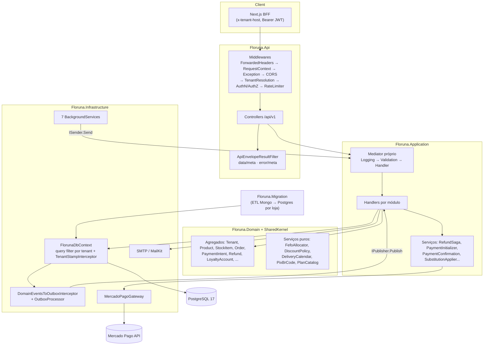
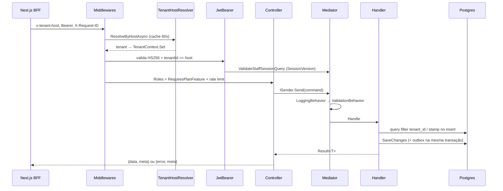
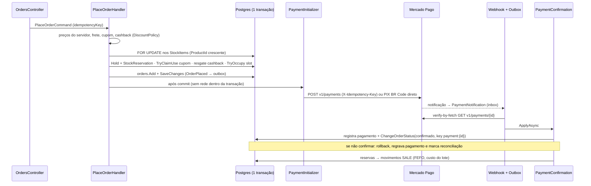
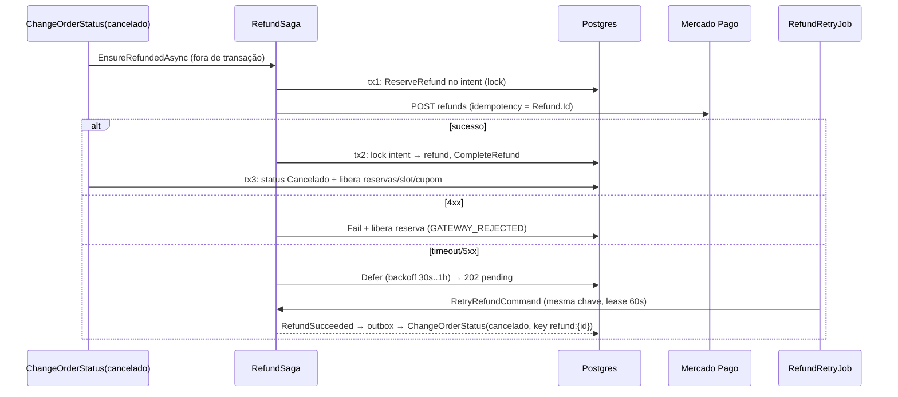
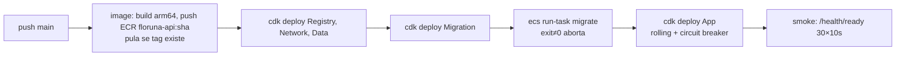

# Codebase Map

> Gerado pelo Cartographer. Último mapeamento: 2026-11-20T13:13:21Z.
> Escopo lido: 336 arquivos (~373k tokens). Ficaram de fora: migrations `*.Designer.cs`/`ModelSnapshot` geradas pelo EF, `infra/cdk.out/` (gitignored) e `docs/openapi/v1.json` (snapshot gerado).

Backend multi-tenant de e-commerce para floriculturas — reescrita em **.NET 10** do backend NestJS 11 + MongoDB (`~/Projects/diprosoft/flora-lis-site/api`), mantendo o **contrato HTTP idêntico** para reutilizar o front Next.js. Monólito modular, Clean Architecture (4 camadas + SharedKernel), DDD, CQRS, **Mediator próprio**, EF Core + PostgreSQL 17, hospedagem AWS (ECS Fargate + RDS, via CDK em C#).

## System Overview



**Regras de dependência** (impostas por `tests/Floruna.ArchitectureTests`):
`SharedKernel ← Domain ← Application ← Infrastructure ← Api`. Domain não conhece EF/AspNetCore/`Microsoft.Extensions`; Application não conhece EF/AspNetCore; Infrastructure não conhece Api.

## Directory Structure

```
floruna-dotnet/
├── Floruna.slnx, global.json (SDK 10.0.100), Directory.Build.props (TreatWarningsAsErrors, estilo no build)
├── Directory.Packages.props        # Central Package Management
├── Dockerfile, docker-compose.yml  # api:4000, postgres:5433, mailpit (profile mail), aspire (profile observability)
├── src/
│   ├── Floruna.SharedKernel/       # Entity, AggregateRoot, Result/Error, Money, Email, TenantId, ITenantOwned
│   ├── Floruna.Domain/             # Agregados por módulo + interfaces de repositório
│   ├── Floruna.Application/        # Mediator, behaviors, comandos/queries/handlers, portas
│   ├── Floruna.Infrastructure/     # EF Core, repositórios, outbox, jobs, gateway MP, SMTP, segurança
│   ├── Floruna.Api/                # Program.cs, middlewares, controllers, envelope, auth
│   └── Floruna.Migration/          # CLI de cutover Nest(Mongo) → .NET(Postgres) por loja
├── tests/
│   ├── Floruna.Domain.UnitTests/       # ~170 testes, sem Docker
│   ├── Floruna.Application.UnitTests/  # Mediator, ValidationBehavior, 3 handlers (NSubstitute)
│   ├── Floruna.ArchitectureTests/      # NetArchTest + varredura de fonte
│   └── Floruna.Api.IntegrationTests/   # WebApplicationFactory + Testcontainers (Postgres; Mongo p/ ETL)
├── infra/                          # AWS CDK em C# (net8.0, solução própria) + testes de infra
├── load/mothers-day.js             # k6 — cenário Dia das Mães
├── tools/api_parity.py             # Paridade de rotas Nest × .NET
└── docs/
    ├── 00-PLANO-REESCRITA-DOTNET.md  # Plano mestre (fases, RNFs, guia de entrevista §17)
    ├── adr/0001..0016              # Decisões (todas "aceita")
    ├── aws.md, migracao.md, paridade-api.md, slo.md
    └── openapi/v1.json             # Snapshot do contrato (verificado por teste)
```

## Module Guide

### SharedKernel

**Propósito**: primitivas sem dependências externas.

| Arquivo | Conteúdo |
|---|---|
| `Entity.cs` | Igualdade por tipo + Id |
| `AggregateRoot.cs` | `Raise(evt)` registra eventos; `IDomainEvent`, `DomainEvent` (EventId UUIDv7) |
| `Result.cs` | `Result`/`Result<T>` (classe), conversões implícitas de `Error` e `T`; `.Value` em falha lança |
| `Error.cs` | `record Error(Code, Message, ErrorType)` + `Issues`, `RetryAfterSeconds`; `Code` é contrato com o front |
| `Money.cs` | `long Cents` + moeda; nunca negativo; `Percent` arredonda *half away from zero* |
| `Email.cs`, `TenantId.cs` | VOs; `ITenantOwned` marca entidades por loja |

`ErrorType` → HTTP: Validation 400 · Unauthorized 401 · Forbidden 403 · NotFound 404 · Conflict 409 · TooManyRequests 429 · Upstream 502 · Failure (regra de negócio) **422**.

### Domain (`src/Floruna.Domain`)

Convenções: construtor privado p/ EF, factory estática retornando `Result<T>` (`Create`, `Place`, `Open`...), `private set`, coleções como `IReadOnlyList`, `DateTimeOffset now` sempre recebido por parâmetro, `XxxErrors` estáticos por módulo, repositórios definidos aqui. Nomes de métodos de repositório expressam concorrência: `GetForUpdate` = `SELECT … FOR UPDATE`; `TryClaim`/`TryTakeSeat`/`TryOccupy`/`TryConsume` = UPDATE condicional (CAS). Tokens públicos guardam só o hash SHA-256 e comparam em tempo constante.

| Módulo | Agregados / tipos-chave | Regras notáveis |
|---|---|---|
| **Platform** | `Tenant`, `TenantSlug`, `PlanCatalog`, `CustomDomainName` | `EffectivePlan`: trial (14 d) conta como Pro; 7 d de carência após `PastDueSince`, depois Free. Planos Free/Essential/Pro/Complete com limites e features (`Pdv`, `Loyalty`, `PaymentGateway`, `CustomDomain`...). Domínio próprio verificado via TXT `_flora-verify.*` |
| **Identity** | `StaffUser`, `SingleUseToken`, `Roles`, `TeamPolicy`, `LoginLockoutPolicy` | `SessionVersion` no JWT; trocar papel/senha revoga sessões. Último master não pode sair/ser rebaixado. Tokens 2FA 10 min, reset 30 min, impersonation 60 s |
| **Customers** | `Customer` | Único por (tenant, email) |
| **Catalog** | `Product`/`ProductVariant`, `Category`, `Collection`, `CatalogSlug` | Preços em `long` cents; promo < preço; ≤12 variantes; `VariantId` estável (`var_`+24 hex). **Produto não guarda estoque** |
| **Inventory** | `StockItem` (+`StockLot`), `StockMovement`, `StockReservation`, `FefoAllocator` | `OnHand` = soma dos lotes (fonte única, D-012). FEFO tudo-ou-nada. Ledger append-only. Reserva 30 min, idempotente |
| **Ordering** | `Order` (maior arquivo, ~5.6k tokens) | Total = Subtotal − Desconto + Frete + Cartão − Cashback. Snapshot de preço **e custo**. Prazo de pagamento 3 h. Máquina de estados só avança (Cancelado de qualquer estado exceto Entregue); `ChangeStatus` com `expectedState` (CAS) e `idempotencyKey` (replay → `Success(null)`). `PlacePos` nasce pago e entregue |
| **Payments** | `PaymentIntent`, `Refund`, `PaymentSettings`, `PaymentNotification`, `PixBrCode` | Intent é a fonte da verdade (Order guarda cópia). Pagamento a menor/atrasado → `FlagReconciliationIssue`, nunca perdido. Saga de reembolso: reserve → gateway → complete; `refunded + reserved ≤ paid`. PIX BR Code puro com CRC16 |
| **Delivery** | `DeliveryZone`, `CapacityRule`, `DeliveryCalendar`, `Cep` | Precedência: blackout > data > recorrente; zona/janela específica > geral. Sem regras = aberto e ilimitado. Janelas 08/13/18 h no fuso da loja |
| **Loyalty** | `LoyaltyProgram`, `LoyaltyAccount`, `DiscountPolicy`, `LoyaltyTiers` | Só cashback (sem pontos). Carteira por **email normalizado**. Cashback é meio de pagamento, não desconto; teto 90% do pedido. Desligado por padrão; exige Pro+ |
| **Promotions** | `Coupon`, `CouponRedemption` | Códigos `COUPON_*` semânticos. `Evaluate` não consome — o consumo é `TryClaimUseAsync` (UPDATE condicional) |
| **Substitutions** | `SubstitutionPolicy`, `SubstitutionProposal` | Modo congelado no checkout (exact/preapproved/ask). `MarkApplied` só a partir de Approved |
| **CustomOrders** | `CustomOrderRequest`, `CustomQuote` | Orçamento versionado; publicar v2 expira v1; conversão única |
| **Pos** | `CashSession` | Esperado = fundo + vendas em dinheiro + suprimento − sangria (nunca digitado). Uma sessão aberta por operador |
| **Workshops** | `Workshop`, `WorkshopRegistration` | Vaga via UPDATE condicional + CHECK. ("events" no contrato Nest) |
| **Audit** | `AuditEntry` | Append-only, visível ao dono da loja (inclusive impersonation) |

**Relações**: Catalog ← Inventory/Ordering/Substitutions/Workshops · Delivery ← Ordering · Ordering ← Payments/Substitutions/CustomOrders · Pos ↔ Ordering só via `CashSessionId`. Referências sempre por Id, sem navegação entre agregados.

### Application (`src/Floruna.Application`)

**Mediator próprio** (`Messaging/`):
- `ICommand`/`ICommand<T>`/`IQuery<T>` sempre retornam `Result`/`Result<T>`; `INotification` + `INotificationHandler<T>` (vários por evento).
- `Mediator` cacheia um wrapper por tipo de request (`ConcurrentDictionary` + `MakeGenericType`); behaviors resolvidos via DI e aplicados em ordem reversa (o primeiro registrado é o mais externo).
- Pipeline: **`LoggingBehavior`** (Activity + log + métrica; falha de negócio deixa o span OK com tags `floruna.error.*`) → **`ValidationBehavior`** (FluentValidation; curto-circuito com `VALIDATION_ERROR`) → handler.
- **Não há behavior de transação, tenant nem autorização** — transação é explícita no handler (`IUnitOfWork.ExecuteInTransactionAsync`), tenant/auth ficam na Api.
- `Publish` é sequencial, sem behaviors; exceção num handler interrompe os seguintes.
- Registro por varredura de assembly (`AddMessaging`); validators como singleton.

**Portas** (`Abstractions/`): `ITenantContext` (`RequiredTenantId` lança `TenantContextMissingException`; `Enter(tenant)` para jobs/webhook/signup), `IUnitOfWork`, `UniqueConstraintViolationException` (Postgres 23505 → detecção de corrida), `IPasswordHasher`, `IAccessTokenIssuer`, `ITenantResolver`, `ILoginAttemptGuard`, `ICredentialHasher`, `IEmailSender` (fila em memória) vs `IEmailDelivery` (síncrono, p/ outbox), `IDnsTxtResolver`, `IPaymentGateway`, `ISecretProtector`, `ICatalogCache`. Leitura via `I*Queries` (projeções SQL direto em DTO).

**Módulos** (um arquivo por grupo de casos de uso: `PlaceOrder.cs`, `OrderStatusAndQueries.cs`, `*Contracts.cs`, `*Ports.cs`...):

| Módulo | Principais requests |
|---|---|
| Catalog | `ListProductsQuery(Managed)` (vitrine com cache, sem custo; painel sem cache), CRUD de Product/Category/Collection |
| Ordering | `PlaceOrderCommand`, `ChangeOrderStatusCommand`, `GetOrderQuery`, `ListOrdersQuery`, `ListMyOrdersQuery`; `OrderEmailHandlers` |
| Payments | `UpdatePaymentSettingsCommand`, `ReceivePaymentWebhookCommand`, `ConfirmManualPaymentCommand`, `PartialRefundCommand`, `RetryRefundCommand`; serviços `PaymentInitializer`, `PaymentConfirmation`, `RefundSaga`, `PaidOrderCancellation` |
| Identity | `LoginStaffCommand` (→ sessão ou 2FA pendente), `VerifyTwoFactorCommand`, login/registro de cliente, reset/troca de senha, time, impersonation; `ValidateStaffSessionQuery` (chamado a cada request autenticado) |
| Tenants | `SignupTenantCommand` (loja + master num único SaveChanges), domínio próprio (request/verify/remove) |
| Inventory | `Restock`, `AdjustStock`, `RegisterLoss`, `ReserveStock`, `Release/ExpireReservation`; queries de lotes/vencimento/estoque baixo |
| Loyalty | Programa, ajuste manual, expiração; `LoyaltyOrderHandlers` (acúmulo em Entregue, estorno em Cancelado) |
| Promotions / Delivery | CRUD de cupons, `ValidateCouponQuery` (só prévia); zonas, regras de capacidade, `QuoteFeeQuery`, `QuotePromiseQuery` |
| Pos / Workshops / Substitutions / CustomOrders | Venda PDV + caixa; eventos e inscrição; propostas com consentimento; pedido personalizado + orçamento |

### Infrastructure (`src/Floruna.Infrastructure`)

- **`FlorunaDbContext`**: Npgsql + snake_case; histórico `__ef_migrations_history`; **todo enum salvo como string (max 32)**; coleções owned como JSON (`orders.items`, `status_history`, `payment_intents.transactions`, ...). É também o `IUnitOfWork`.
- **Multi-tenancy em 3 camadas**: (1) query filter global em todo `ITenantOwned` que **lança** sem tenant (fail-closed); (2) `TenantStampInterceptor` sobrescreve `TenantId` no insert e proíbe troca/alteração de outra loja; (3) índices compostos começando por `tenant_id`.
- **`ExecuteInTransactionAsync`**: sem retry automático; rollback + limpa ChangeTracker se `Result.IsFailure`; reaproveita transação existente. Locks via `SELECT 1 … FOR UPDATE` (exigem transação aberta).
- **Outbox**: `DomainEventsToOutboxInterceptor` grava eventos em `outbox_messages` no mesmo SaveChanges (com `traceparent`). `OutboxProcessor` (2 s, lote 20, lease 5 min) usa `FOR UPDATE SKIP LOCKED`, recibo por handler (`outbox_receipts`), backoff 30 s·2ⁿ até 1 h, **Dead após 10 tentativas**. DLQ visível em `/platform/outbox` (superadmin).
- **Jobs** (`PeriodicTimer`, todos respeitam `BackgroundJobs:Enabled`, padrão true): ReservationExpiry 1 min, AbandonedOrders 1 min, RefundRetry 30 s, LoyaltyExpiry 15 min, CustomQuoteExpiry 30 min, SubstitutionExpiry 10 min, Outbox 2 s. Padrão: query cross-tenant → por item, novo scope + `TenantContext` + comando. `EmailDispatcher` não respeita a flag.
- **`MercadoPagoGateway`** (ACL): typed HttpClient com resiliência (8 s/tentativa, 20 s total, 2 retries, circuit breaker); `X-Idempotency-Key` torna o retry de POST seguro. 4xx (exceto 408/429) = recusa definitiva.
- **Segurança**: BCrypt custo 10 (compatível com bcryptjs do Nest); `AesGcmSecretProtector` (`v1:` + nonce|tag|cipher, tenant como AAD); chave por base64 32 bytes ou passphrase ≥48 chars via HKDF; `LoginAttemptGuard` com upsert atômico e chaves HMAC (sem PII).
- **Cache**: `HybridCatalogCache` em memória, tag por loja, TTL 5 min — **sem Redis**, réplicas podem servir dado velho até 5 min.
- **Tenant resolver**: `TenantHostResolver` (IMemoryCache, `Platform:CacheTtl` 60 s). `localhost`/IP/domínio da plataforma → slug padrão (`flora-lis`); `x.localhost` e `x.{Platform:Domain}` → slug `x`; demais → domínio próprio verificado.

### Api (`src/Floruna.Api`)

- **`Program.cs`**: `AddApplication` → `AddInfrastructure` → `AddPresentation`. `args[0] == "migrate"` roda só as migrations e sai (modo task ECS). Senão: `UsePresentation` → migrate opcional + seed idempotente → `RunAsync`.
- **Pipeline**: ForwardedHeaders (só proxies confiáveis) → `RequestContextMiddleware` (X-Request-ID, X-Trace-Id, headers de segurança) → ExceptionHandler → StatusCodePages → Routing → CORS → **`TenantResolutionMiddleware`** (antes da auth) → AuthN → AuthZ → RateLimiter → `MapControllers().RequireAuthorization()` (**auth por padrão**; rotas públicas precisam de `[AllowAnonymous]`).
- **Envelope**: `ApiEnvelopeResultFilter` embrulha `ObjectResult` de `/api/v1` em `{data, meta}`; controllers chamam `Failure(Error)` → `{error:{code,message,issues?}, meta}`. `meta.timestamp` no formato `toISOString` do JS.
- **JWT**: HS256, sem issuer/audience (paridade Nest), `MapInboundClaims=false`, skew 30 s. `OnTokenValidated`: recusa token `purpose=2fa`; exige `tenantId` == loja do host (exceto superadmin); para staff, valida `SessionVersion` via `ValidateStaffSessionQuery`. Staff 8 h, cliente 7 d, impersonation 15 min.
- **Autorização**: `[Authorize(Roles = Roles.Admins | PointOfSale | ...)]` + `[RequiresPlanFeature(PlanFeature.X)]` (lê `EffectivePlan`; superadmin ignora).
- **Rate limit**: janela fixa em memória por réplica, partição `x-tenant-host|IP`. `auth` 5/min, `checkout` 30/min.
- **Health**: `/api/v1/health/live` (sempre 200), `/health` e `/health/ready` (checa DB) — mesmo formato do Nest.
- **Controllers** (todos em `/api/v1`): `auth`, `tenants`, `users`, `products`, `categories`, `collections`, `stock`, `orders` (inclui `pos` e `resolutions/refund|substitution`), `coupons`, `delivery-zones`, `delivery-capacity`, `delivery-promises`, `settings/payments`, `payments` (webhook sempre 200), `loyalty`, `events`, `cash-sessions`, `custom-orders`, `custom-quotes`, `substitutions`, `substitution-policy`, `platform/outbox`, `health`.

### Migration (`src/Floruna.Migration`)

CLI de cutover **por loja** (ADR 0016): `dotnet run --project src/Floruna.Migration -- --mongo <uri> --mongo-db <db> --tenant <slug> [--dry-run] [--replace] [--force]`.
- Uma transação Postgres: elegibilidade (bloqueia loja com pedido `pendente` ou dados de módulos não portados, salvo `--force`) → `--replace` apaga a loja existente → importa (tenant, staff, clientes, catálogo, estoque FEFO, cupons, zonas, settings, pedidos + intents) → **conciliação** (contagens, unidades, totais em centavos) → commit ou rollback.
- IDs determinísticos UUID v5 (`LegacyIds.For`); `Restore.Set` (reflection) restaura campos históricos; hashes bcrypt, links de rastreio e token MP (re-criptografado) migram; eventos de domínio descartados.
- Env: `ConnectionStrings__Floruna`/`Database__*`, `Secrets__EncryptionKey`, `NEST_SETTINGS_ENCRYPTION_KEY`.

### Tests (`tests/`)

| Projeto | Stack | Docker? |
|---|---|---|
| Domain.UnitTests | xUnit + Shouldly + FakeTimeProvider | não |
| Application.UnitTests | + NSubstitute | não |
| ArchitectureTests | NetArchTest + varredura de `src/**/*.cs` | não |
| Api.IntegrationTests | WebApplicationFactory + Testcontainers (postgres:17-alpine; mongo:7 só p/ ETL) | **sim** |

- **Sem FluentAssertions e sem Moq** (Shouldly + NSubstitute).
- `FlorunaApiFactory` sobe **um** Postgres para a suíte inteira; todas as classes usam `[Collection(ApiCollection.Name)]` e rodam em série. Isolamento = **uma loja nova por teste** (`SignupStoreAsync` + slug aleatório); o banco nunca é resetado.
- Helpers (`Support/TestApi.cs`): `ForStore(slug, token)`, `SignupStoreAsync`, `LoginStaffAsync`, `.Data()`, `.ErrorBody()`. Fakes: `CapturingEmailTransport` (`WaitForAsync`), `FakeDnsTxtResolver`, `FakeMercadoPago` (HttpMessageHandler com knobs `Down`, `RejectRefunds`, `LoseRefundResponses`).
- Jobs desligados nos testes; os testes chamam `OutboxProcessor.ProcessOnceAsync` etc. diretamente via `factory.Services`.
- `OpenApiContractTests` compara com `docs/openapi/v1.json`; aceitar mudança: `UPDATE_OPENAPI_SNAPSHOT=1 dotnet test`.

### Infra AWS (`infra/`, CDK C#, sa-east-1)

Solução separada (net8.0, `Floruna.Infra.sln`, requer Node). Stacks: `Floruna-GitHubDeploy` (OIDC, uma vez) · `Floruna-Registry` (ECR imutável) · `Floruna-{env}-Network` (VPC 3 camadas, **todos os SGs aqui** p/ evitar ciclo) · `-Data` (RDS PG17 Graviton, secrets jwt/encryption-key RETAIN) · `-Migration` (task `migrate` em cluster próprio) · `-App` (ECS `ApiService` com jobs off + `WorkerService` com jobs on, ALB + WAF, ADOT sidecar, 6 alarmes). cdk-nag em tudo; ~17 testes de infra. **Sintetiza e passa nos testes, mas ainda não foi implantado** (`docs/aws.md`).

## Data Flow

### Request autenticado



### Checkout → pagamento → confirmação



### Cancelamento de pedido pago (saga de reembolso)



### Deploy (GitHub Actions → AWS)



## Conventions

- **Idioma**: nomes de tipos em inglês; comentários, mensagens de erro e docs em pt-BR. Strings de contrato (status, papéis, métodos de pagamento) espelham o Nest — **não traduzir nem renomear** (`em_preparo`, `caixa`, `dinheiro`...).
- **Erros de negócio nunca lançam**: `return XxxErrors.Y;` (conversão implícita para `Result`). Exceção só para falha de infraestrutura — e propositalmente em handlers de outbox, para forçar retry.
- **Handlers** `internal sealed`; commands/queries/DTOs/portas `public`. Nomes: `VerbNounCommand`, `Get/ListXQuery`, `<Request>Validator`, `*Response`/`*Envelope`/`*Page`.
- **Dinheiro** sempre `long` cents (agregados usam `long XxxCents`; `Money` aparece como view/validação). **Proibido `double`/`float`** em Domain/SharedKernel (teste de arquitetura).
- **Tempo** sempre `TimeProvider` injetado — `DateTime.UtcNow/Now` em `src/` quebra o teste de arquitetura.
- **Unicidade** (slug, SKU, email, chave idempotente) pelo índice único do banco + captura de `UniqueConstraintViolationException` — sem pré-select.
- **Chaves idempotentes determinísticas**: `order:{id}:{idx}`, `sale:{order}:{idx}`, `payment:{intentId}`, `refund:{id}`, `abandoned:{id}`, `substitution:{id}:out|in`, `cashback:earn|redeem|reverse:{orderId}`.
- **Ordem de locks**: estoque sempre por `ProductId` crescente; reembolso trava intent e depois refund.
- **PATCH** com `Optional<T>` (ausente ≠ `null`).
- **Datas** em DTO via `CatalogMapping.Iso()` (`yyyy-MM-ddTHH:mm:ss.fffZ`).
- **Build estrito**: `TreatWarningsAsErrors` + `EnforceCodeStyleInBuild` (inclusive testes); CI roda `dotnet format --verify-no-changes`.
- **ADRs** em `docs/adr/` registram cada fase, incluindo tabelas de "Diferenças conscientes" em relação ao Nest.

## Gotchas

**Transações e concorrência**
- `ExecuteInTransactionAsync` faz rollback quando o `Result` falha. Por isso, expirações (consentimento, orçamento) usam o padrão "persiste a expiração, commita e só então retorna o erro".
- Nenhuma chamada de rede dentro de transação: o pagamento é criado após o commit do checkout, o gateway de reembolso fica entre transações e o webhook é processado via outbox.
- Lição repetida nos ADRs 0007–0013: carregar a entidade *tracked* antes do `FOR UPDATE` derrota o lock (identity resolution do EF). Use `AsNoTracking` ou leia de novo depois do lock. `EnableRetryOnFailure` está desligado; o cliente reenvia com a mesma chave idempotente.
- Cancelar **após** confirmação não devolve estoque (perecível exige inspeção).
- `StockItem.Withdraw` reduz `Reserved` para caber em `OnHand`, então uma perda ou um ajuste negativo pode encolher reservas silenciosamente.
- `StockReservation` não altera o `StockItem`. A aplicação precisa chamar `Hold`/`ReleaseHold` à parte.
- `Mediator.Publish` não passa pelos behaviors, então handlers de notificação não têm logging/métrica automáticos.

**Multi-tenancy**
- Acesso ao banco sem tenant lança `TenantContextMissingException`, e **nada captura essa exceção** (`GlobalExceptionHandler` só trata `BadHttpRequestException`), então ela vira 500. Isso acontece, por exemplo, em rota pública com domínio próprio não verificado ou subdomínio de vários níveis.
- `IgnoreQueryFilters` só é permitido nos arquivos da allowlist em `tests/Floruna.ArchitectureTests/SourceRulesTests.cs`. Um uso novo exige entrada nessa lista e justificativa.
- `x-tenant-host` é confiado (presume API em rede privada atrás do BFF).
- Mensagem de outbox cuja loja foi apagada, ou com tipo desconhecido, acaba **Dead**.

**Config e operação**
- O boot falha (`ValidateOnStart`) sem: conexão com o banco, `Jwt:Secret`/`AUTH_SECRET` (≥32 chars), `Secrets:EncryptionKey` e CORS válido. `appsettings.json` não traz segredos; os valores de dev ficam em `appsettings.Development.json`.
- O segredo JWT também serve de chave para o HMAC do login lockout e do código 2FA. **Rotacionar invalida sessões, OTPs pendentes e contadores de bloqueio.**
- `AUTH_SECRET` precisa ser igual ao do front (`proxy.ts`).
- `Database:MigrateOnStartup` é false por padrão. Em produção, rode `dotnet Floruna.Api.dll migrate` (task ECS). O health check só testa conectividade, não o schema.
- `BackgroundJobs:Enabled` é **true por padrão**: toda réplica roda todos os jobs, a menos que você desligue (o CDK desliga na `ApiService`).
- Sem `Smtp:Host` não há e-mail **nem 2FA**. A fila `BackgroundEmailQueue` (OTP, reset de senha) é em memória e perde mensagens se o processo cair. Os e-mails via outbox são duráveis.
- Scalar (`/api/docs`) e OpenAPI ficam expostos **em todos os ambientes**, inclusive produção (`PresentationExtensions.cs:95-96`).
- Rate limit e cache de catálogo são por réplica (sem Redis).
- `Dockerfile` não inclui `Floruna.Migration`. O `migrate` do ECS é o modo CLI da própria Api, não o ETL.
- Migrations precisam ser expand/contract (duas versões rodam juntas no rolling update). Nunca edite uma migration já aplicada.
- O SDK raiz é .NET 10, mas `infra/` usa .NET 8 + Node. Na máquina local só havia o SDK 8, então os builds rodam no container `mcr.microsoft.com/dotnet/sdk:10.0` até instalar o `dotnet-sdk-10.0`.

**Contrato**
- Qualquer mudança de rota/DTO/XML doc quebra `OpenApiContractTests`. Regenere com `UPDATE_OPENAPI_SNAPSHOT=1` e revise o diff.
- A paridade com o Nest é ~40% (115/282 operações, `docs/paridade-api.md`). `tools/api_parity.py` compara só método+rota, não schema.

**Testes**
- Toda classe de integração nova **precisa** de `[Collection(ApiCollection.Name)]`, senão cria outro container e corre risco de migrations concorrentes.
- Nunca assuma contagens globais (banco compartilhado). Escopo é sempre a sua loja.
- Para e-mail, use `WaitForAsync` (fila assíncrona).

## Navigation Guide

**Adicionar um endpoint novo**
1. Command/query + validator + handler (`internal sealed`) em `src/Floruna.Application/<Módulo>/`. O registro é automático.
2. Se precisar de dados novos: interface de repositório em `src/Floruna.Domain/<Módulo>/`, implementação em `src/Floruna.Infrastructure/<Módulo>/`, registro em `src/Floruna.Infrastructure/DependencyInjection.cs`.
3. Action em `src/Floruna.Api/Controllers/<X>Controller.cs` (`ISender.Send`, `[Authorize(Roles=…)]` ou `[AllowAnonymous]`, `[RequiresPlanFeature]` se for pago, `[EnableRateLimiting]` se for público e sensível).
4. Teste de integração em `tests/Floruna.Api.IntegrationTests/` + `UPDATE_OPENAPI_SNAPSHOT=1 dotnet test`.

**Adicionar uma regra de negócio**: no agregado em `src/Floruna.Domain/<Módulo>/`, com erro em `<Módulo>Errors` e teste em `tests/Floruna.Domain.UnitTests/<Módulo>/`.

**Reagir a um evento de domínio**: `INotificationHandler<DomainEventNotification<TEvent>>` na Application. Precisa ser idempotente e **lançar** para pedir retry.

**Novo job periódico**: `BackgroundService` em `src/Floruna.Infrastructure/`, checando `BackgroundJobsOptions`. Segue o padrão query cross-tenant → `TenantContext.Enter` → comando por item. Se usar `IgnoreQueryFilters`, adicione o arquivo à allowlist.

**Nova tabela/coluna**: configuração EF em `src/Floruna.Infrastructure/Persistence/`, depois `dotnet tool restore && dotnet ef migrations add <Nome> -p src/Floruna.Infrastructure -s src/Floruna.Infrastructure`. Confira com `dotnet ef migrations has-pending-model-changes`.

**Mexer em auth/sessão**: `src/Floruna.Api/Security/AuthenticationSetup.cs`, `src/Floruna.Infrastructure/Security/`, `src/Floruna.Application/Identity/`, `src/Floruna.Domain/Identity/`.

**Mexer em multi-tenancy**: `src/Floruna.Api/` (`TenantResolutionMiddleware`), `src/Floruna.Infrastructure/Tenancy/TenantHostResolver`, `FlorunaDbContext` (query filter) e `TenantStampInterceptor`. ADR 0002.

**Pagamentos/reembolso**: `src/Floruna.Application/Payments/` (`RefundSaga`, `PaymentConfirmation`), `src/Floruna.Infrastructure/Payments/MercadoPagoGateway`, `src/Floruna.Domain/Payments/`. ADRs 0006 e 0008.

**Infra AWS**: `infra/src/Floruna.Infra/Stacks/*.cs` + `infra/tests/`. Rode `cd infra && dotnet test` e depois `cdk synth`. ADR 0011 e `docs/aws.md`.

**Migrar uma loja do Nest**: `docs/migracao.md` e ADR 0016. Rode sempre com `--dry-run` primeiro.

**Comandos rápidos**
```bash
docker compose up --build                       # API em :4000, docs em /api/docs
dotnet test tests/Floruna.Domain.UnitTests      # rápido, sem Docker
dotnet test Floruna.slnx                        # tudo (precisa de Docker)
UPDATE_OPENAPI_SNAPSHOT=1 dotnet test           # aceitar mudança de contrato
```
