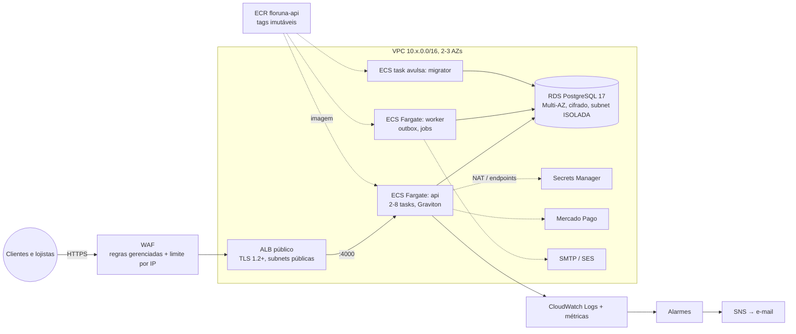

# Floruna na AWS (Fase 7)

Infraestrutura como código em **AWS CDK (C#)**, em `infra/`. Este documento é o guia de arquitetura e de
operação; as decisões e os porquês estão na [ADR 0011](adr/0011-producao-na-aws.md).

> **Estado:** a infraestrutura sintetiza, passa nos testes (asserções no CloudFormation + cdk-nag) e o
> contrato do container foi validado com a imagem real. **Ainda não foi implantada numa conta AWS.**

## 1. Visão geral



| Pilha | Conteúdo | Ciclo de vida |
|---|---|---|
| `Floruna-GitHubDeploy` | Provedor OIDC do GitHub + role de deploy (sem chave de acesso) | uma vez, por um administrador |
| `Floruna-Registry` | ECR `floruna-api` (compartilhado: a mesma imagem vai de staging para produção) | raramente muda |
| `Floruna-{env}-Network` | VPC (pública / app / dados isolada), NAT, endpoints, flow logs, security groups | raramente muda |
| `Floruna-{env}-Data` | RDS PostgreSQL, segredos (banco, JWT, chave de cifra) | protegida contra exclusão em prod |
| `Floruna-{env}-Migration` | Cluster de tarefas avulsas + task `migrator` | a cada deploy, ANTES da app |
| `Floruna-{env}-App` | Cluster, serviços `api` e `worker`, ALB, WAF, autoscaling, alarmes | a cada deploy |

As dependências apontam num sentido só (rede → dados → migração/app). Os security groups moram todos na pilha
de rede: regras entre SGs de pilhas diferentes criariam referência circular.

## 2. Uma imagem, três papéis

A mesma imagem (tag = SHA do commit) roda como:

| Papel | Como | Por quê |
|---|---|---|
| `api` | `BackgroundJobs__Enabled=false`, atrás do ALB | escala por CPU/requisições sem disputar com jobs |
| `worker` | `BackgroundJobs__Enabled=true`, sem load balancer | outbox, expiração de reservas/cashback, retentativa de reembolsos |
| `migrator` | comando `migrate`: aplica as migrations e sai | roda ANTES da troca das tasks, com o binário da versão nova |

Configuração 12-factor: tudo por variável de ambiente. Os **segredos** chegam pelo campo `secrets` da task
(Secrets Manager → ECS na partida), nunca no template. O banco chega **campo a campo** (`Database__Host`,
`Database__Password`...) e a aplicação monta a connection string com `NpgsqlConnectionStringBuilder` (TLS obrigatório).

## 3. Primeiro deploy (runbook)

Pré-requisitos: conta AWS, AWS CLI autenticado como administrador, Node.js 22, .NET 8+.

1. **Bootstrap do CDK** (cria as roles e o bucket que o CDK usa para implantar):
   ```bash
   cd infra
   npx aws-cdk@2 bootstrap aws://<CONTA>/sa-east-1
   ```
2. **Confiança do GitHub** (uma vez):
   ```bash
   npx aws-cdk@2 deploy Floruna-GitHubDeploy -c account=<CONTA> -c githubRepo=<dono>/<repo>
   ```
   Anote a saída `DeployRoleArn`.
3. **Certificado** (produção): emita no ACM, em `sa-east-1`, para `api.floruna.com.br` (validação por DNS).
4. **GitHub** → Settings:
   - *Secrets*: `AWS_DEPLOY_ROLE_ARN`, `AWS_ACCOUNT_ID`, `PROD_CERTIFICATE_ARN`.
   - *Variables* (opcional): `ALARM_EMAIL`.
   - *Environments*: `staging` e `prod`; em `prod`, **Required reviewers** (aprovação manual).
5. **`cdk.context.json`**: rode `npx aws-cdk@2 synth -c account=<CONTA>` uma vez com credencial e faça commit do
   arquivo atualizado (lista de AZs da conta). Synth sem chamadas à AWS = builds reprodutíveis.
6. **Ligar o deploy**: *Variables* → `DEPLOY_ENABLED` = `true` (até lá, o workflow é pulado).
7. **Deploy**: push na `main` (staging) ou *Actions → Deploy → Run workflow → prod*.
8. **DNS**: aponte `api.<domínio>` (CNAME/alias) para a saída `ApiUrl` da pilha App. Configure o BFF com essa URL.

## 4. Pipeline de deploy (`.github/workflows/deploy.yml`)

1. **Imagem**: build ARM64 (Graviton) e push no ECR com tag = SHA. Se a tag já existe, não reconstrói
   (*build once, deploy many*: a imagem aprovada em staging é byte a byte a de produção).
2. **Infra de base**: `cdk deploy` Registry, Network, Data.
3. **Migration**: `cdk deploy` da pilha Migration com a imagem nova → `aws ecs run-task` → espera → exit code 0.
   Falhou? O pipeline para e **a API não é atualizada**.
4. **Aplicação**: `cdk deploy` App. Rolling update (100%/200%) com **circuit breaker + rollback automático**.
5. **Smoke test**: `GET /api/v1/health/ready` pela URL pública.

**Migrations precisam ser compatíveis com a versão anterior** (expand/contract): durante o rollout as duas
versões rodam juntas sobre o schema novo. Renomear coluna = adicionar a nova, copiar, trocar o código, e só
num deploy seguinte remover a antiga.

## 5. Operação

| Situação | O que fazer |
|---|---|
| Deploy ruim | O circuit breaker reverte sozinho se as tasks não ficam saudáveis. Para voltar uma versão saudável mas errada: *Re-run* do workflow do commit anterior (tags imutáveis garantem a mesma imagem). |
| Migration falhou | O pipeline parou antes da app. Leia o log do grupo `MigratorLogs`, corrija com uma migration NOVA (nunca edite uma aplicada). |
| Restaurar o banco | PITR do RDS para um horário (cria instância nova) → atualize o campo `host` do segredo `floruna/<env>/database` → force novo deploy dos serviços. |
| Investigar erro | Peça ao cliente o `X-Trace-Id` da resposta e abra o trace no X-Ray (inclui o processamento assíncrono). Nos logs (Logs Insights, JSON), filtre pelo mesmo `TraceId`. |
| Pico (Dia das Mães) | Autoscaling já cobre até `ApiMaxTasks`. Antecipe subindo `ApiMinTasks` no dia anterior. |
| Mensagens na fila de mortas | `GET /api/v1/platform/outbox?state=dead` (superadmin) e `POST .../retry`. |

## 6. Well-Architected

| Pilar | Como está atendido |
|---|---|
| **Excelência operacional** | IaC testada (asserções + cdk-nag no CI); deploy automatizado com migrations antes da app; logs estruturados; traces no X-Ray (sidecar ADOT) que atravessam a outbox; runbooks acima. |
| **Segurança** | Banco em subnet isolada, SG só a partir das tasks; segredos no Secrets Manager e injetados pelo ECS; cifra em repouso (RDS, S3) e em trânsito (TLS 1.2+ no ALB, TLS no banco); WAF; OIDC sem chave de acesso; tags de imagem imutáveis com scan; menor privilégio (migrator só vê o banco); `X-Forwarded-For` só aceito da VPC; flow logs de tráfego rejeitado. |
| **Confiabilidade** | Multi-AZ (RDS standby síncrono, tasks em 3 AZs, um NAT por AZ em prod); health check com o banco; circuit breaker; backups com PITR (14 dias) e snapshot na exclusão; outbox com retry/DLQ; jobs seguros com várias réplicas. |
| **Eficiência de performance** | Target tracking (CPU 60% e 1000 req/task); `api` e `worker` escalam separados (bulkhead); Graviton; pool de conexões dimensionado. |
| **Otimização de custos** | Graviton (~20% mais barato) em Fargate e RDS; staging enxuto (1 NAT, single-AZ, sem endpoints); retenção de logs e lifecycle no ECR/S3; tags `environment` para o Cost Explorer. |
| **Sustentabilidade** | Graviton (mais eficiente por watt); escala para baixo fora de pico; nada ocioso superdimensionado em staging. |

## 7. Custo estimado (ordem de grandeza)

Valores **aproximados** para `sa-east-1` sob demanda, antes de tráfego. Confirme na
[AWS Pricing Calculator](https://calculator.aws/); preços mudam e São Paulo é mais cara que `us-east-1`.

| Item | Staging | Produção |
|---|---|---|
| NAT Gateway | 1 (~US$ 70) | 2 (~US$ 140) |
| ALB + WAF | ~US$ 35 | ~US$ 45 |
| Fargate (ARM) | 2 tasks pequenas (~US$ 25) | 2-8 api + 1 worker (~US$ 60+) |
| RDS PostgreSQL | t4g.micro single-AZ (~US$ 30) | t4g.medium Multi-AZ (~US$ 200) |
| VPC endpoints (interface) | não | 4 serviços × 3 AZs (~US$ 110) |
| Secrets, logs, S3, CloudWatch | ~US$ 10 | ~US$ 30 |
| **Total aproximado** | **~US$ 170/mês** | **~US$ 590/mês** |

Alavancas: Savings Plans (Fargate) e instância reservada (RDS) cortam 30-50% em produção; os endpoints de
interface só compensam quando o tráfego pelo NAT (imagens, logs) é alto. Com pouco tráfego, removê-los
economiza ~US$ 110/mês.

## 8. Limitações conhecidas (backlog)

- **Cache por task**: o HybridCache é local; numa loja com 4 tasks, uma alteração de catálogo leva até
  `Platform:CacheTtl` (60 s) para refletir nas outras. Evolução: ElastiCache (Redis) como L2 + invalidação.
- **Rotação de senha do banco** desligada (exige reler a senha sem reiniciar: `UsePeriodicPasswordProvider`).
- **TLS do banco** em `Require` (cifra, mas não valida o certificado). `VerifyFull` exige o bundle de CAs do RDS na imagem.
- **Data Protection** do ASP.NET com chaves efêmeras por task (a API não usa hoje; viraria problema com cookies/antiforgery).
- **Superadmin inicial** em produção: hoje via seed (variáveis `Seed__*`). Falta um comando `seed` avulso, com a senha lida do Secrets Manager.
- Alarmes nas métricas da outbox (`floruna.outbox.oldest_pending_age`, `dead_letters`), publicadas via EMF pelo coletor ADOT.
- CloudFront na frente (cache de vitrine, Shield Standard na borda); multi-região (DR) com réplica cross-region.
